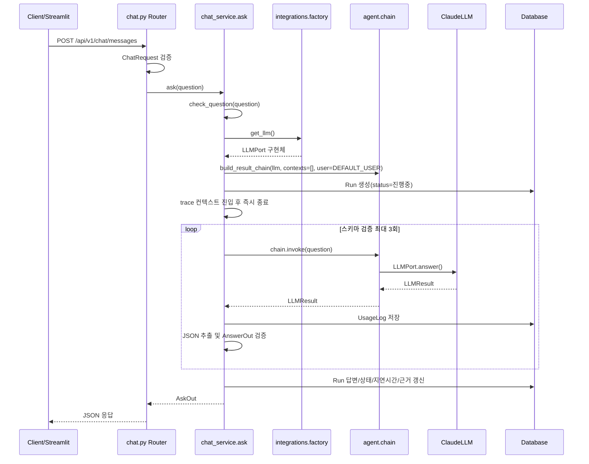

# Hanwha Agent 개발 흐름

이 문서는 현재 `hanwha-agent` 코드 기준으로 애플리케이션이 어떻게 시작되고, 요청이 어떤 계층을 거쳐 처리되며, 각 디렉터리가 어떤 책임을 가지는지 정리한 개발 안내서입니다.

## 1. 프로젝트 한눈에 보기

Hanwha Agent는 다음 기능을 중심으로 구성되어 있습니다.

- FastAPI 기반 백엔드 API
- 사번과 비밀번호를 사용하는 임시 인증 기능
- 사내 문서 목록 조회, 문서 업로드 및 버전 관리
- Claude 기반 질문 응답 에이전트
- LLM 응답 JSON 검증, 재시도, 폴백 응답
- 실행 이력, 토큰 사용량, 예상 비용 저장
- Streamlit 기반 내부 운영 화면
- SQLAlchemy 기반 데이터 접근
- Langfuse 연동을 통한 추적 및 평가 기반

현재 코드는 기능을 확장하기 위한 기본 골격과 핵심 호출 흐름이 마련된 단계입니다. 특히 문서 색인/RAG, JWT 인증, 실제 사용자와 채팅 요청의 연결은 후속 개발 영역으로 남아 있습니다.

## 2. 전체 개발 트리

```text
hanwha-agent/
├── docker-compose.yml                 # PostgreSQL, pgvector, 선택적 Langfuse 실행 환경
├── pyproject.toml                     # pytest 경로 및 테스트 설정
├── uploads/                           # 업로드된 문서 파일 저장 위치
├── backend/
│   ├── main.py                        # 보조/구형 FastAPI 진입점
│   ├── alembic.ini                    # Alembic 설정 진입점
│   ├── zz_check_login.py              # 로그인 확인용 보조 스크립트
│   ├── app/
│   │   ├── main.py                    # 실제 FastAPI 애플리케이션 진입점
│   │   ├── agent/
│   │   │   ├── chain.py               # 프롬프트와 LLMPort를 Runnable 체인으로 연결
│   │   │   └── prompts/
│   │   │       └── answer_system.md   # 답변 생성용 시스템 프롬프트
│   │   ├── api/
│   │   │   └── v1/
│   │   │       ├── auth.py            # 로그인, 현재 사용자 조회 API
│   │   │       ├── chat.py            # 질문 및 실행 기록 API
│   │   │       ├── documents.py       # 문서 목록, 업로드, 단건 조회 API
│   │   │       └── deps.py            # API 의존성 주입 타입
│   │   ├── core/
│   │   │   ├── config.py              # 환경변수와 앱 설정
│   │   │   ├── exceptions.py          # 도메인 예외와 HTTP 상태 매핑 정보
│   │   │   ├── guards.py              # 질문/모델 입력 검증
│   │   │   ├── logging.py             # 로깅 설정과 로거 생성
│   │   │   └── security.py            # 비밀번호 해시와 검증
│   │   ├── db/
│   │   │   ├── session.py             # SQLAlchemy 엔진, 세션, 트랜잭션
│   │   │   ├── init_db.py             # 모델 메타데이터 기반 테이블 생성
│   │   │   ├── seed.py                # 초기 데이터 삽입
│   │   │   ├── seed_data.py           # 부서, 사용자, 문서 샘플 데이터
│   │   │   └── migrations/            # DB 마이그레이션 영역
│   │   ├── integrations/
│   │   │   ├── ports.py               # LLMPort와 LLMResult 계약
│   │   │   ├── factory.py              # 설정에 맞는 LLM 어댑터 선택
│   │   │   ├── llm_claude.py           # Claude Messages API 어댑터
│   │   │   └── langfuse_client.py     # trace, score 관측성 연동
│   │   ├── models/
│   │   │   ├── base.py                # SQLAlchemy Base와 공통 시간 필드
│   │   │   ├── org.py                 # Department, User
│   │   │   ├── document.py            # Document, DocumentVersion
│   │   │   ├── run.py                 # Run, RunStep
│   │   │   └── usage.py               # UsageLog
│   │   ├── repositories/
│   │   │   ├── user_repo.py           # 사번 기준 사용자 조회
│   │   │   └── document_repo.py       # 문서/버전 조회와 버전 추가
│   │   ├── schemas/
│   │   │   ├── auth.py                # 로그인 및 사용자 응답 모델
│   │   │   ├── chat.py                # 질문, 답변, 근거 스키마
│   │   │   ├── document.py            # 문서 API 스키마
│   │   │   └── common.py              # 공통 응답 스키마
│   │   ├── services/
│   │   │   ├── auth_service.py        # 인증 업무 흐름
│   │   │   ├── chat_service.py        # 질문 처리 전체 오케스트레이션
│   │   │   ├── document_service.py    # 문서 업무 흐름
│   │   │   └── ids.py                 # 실행 ID 생성
│   │   └── frontend/
│   │       ├── app.py                 # Streamlit 메인 화면
│   │       ├── appex.py               # Streamlit 실행 보조
│   │       ├── core/                  # 프론트 공통 로직/API 클라이언트
│   │       ├── ui/                    # 공통 UI 구성요소
│   │       ├── views/                 # 화면별 뷰
│   │       └── asset/                 # 정적 리소스
│   └── tests/
│       ├── conftest.py                # 테스트 fixture
│       ├── test_health.py             # 상태 확인 테스트
│       ├── test_chat_golden.py        # 채팅 골든 테스트
│       ├── test_layers.py             # 계층 의존 방향 테스트
│       ├── test_core_config.py        # 설정 테스트
│       ├── test_exceptions.py         # 예외 테스트
│       ├── test_guards.py             # 입력 가드 테스트
│       └── golden/
│           └── chat_golden.json       # 채팅 기대 결과 데이터
└── sandbox/                           # 학습 및 실험 코드
```

## 3. 애플리케이션 시작 흐름

실제 API 서버의 진입점은 `backend/app/main.py`입니다.

```text
Python/Uvicorn이 app.main:app import
  -> FastAPI 객체 생성
  -> /health 및 /api/v1 라우터 등록
서버 시작 이벤트
  -> lifespan 진입
      -> setup_logging()
      -> init_db()
          -> SQLAlchemy Base.metadata.create_all()
      -> seed_all()
          -> 부서/사용자/문서/문서 버전 초기 데이터 생성
  -> yield 이후 요청 수신
서버 종료 이벤트
  -> lifespan의 yield 이후 구간 실행
  -> 현재는 별도 종료 작업 없음
```

라우터 등록은 `lifespan` 안이 아니라 `app` 객체를 만들 때 실행됩니다. DB 테이블 생성과 시드 데이터 처리는 서버 시작 시 `lifespan` 진입 후 실행되며, 이 작업이 끝나야 요청을 받을 수 있습니다. `seed_all()`은 문서 테이블에 데이터가 이미 있으면 전체 시드 삽입을 건너뜁니다.

### 설정과 실행 모드

`core/config.py`의 `Settings`가 `.env`와 환경변수를 읽습니다.

- `APP_MODE`: `mock` 또는 `live`
- `ANTHROPIC_API_KEY`: Claude 호출 키
- `LLM_MODEL`, `MAX_TOKENS`, `TEMPERATURE`: 모델 호출 설정
- `DATABASE_URL`: 기본값은 `sqlite:///./app.db`
- `LANGFUSE_ENABLED`, Langfuse 키/호스트: 관측성 설정

현재 `integrations/factory.py`는 `live` 모드가 아닐 때 테스트용 mock을 제공하지 않고 `ModeNotAvailable`을 발생시킵니다. 따라서 채팅 API를 실제로 호출하려면 live 설정과 Claude 의존성이 필요하며, 테스트에서는 `factory.get_llm`을 Stub으로 교체합니다.

## 4. 계층 구조와 의존 방향

```text
API Router
    ↓ 요청을 받고 응답 모델을 적용
Service
    ↓ 업무 규칙, 트랜잭션, 외부 포트 호출 조정
Repository / Agent Chain / Integration Factory
    ↓ DB 조회, LLM 체인 구성, 어댑터 선택
Model / LLM Adapter
    ↓ 영속화 또는 외부 API 호출
Database / Claude / Langfuse
```

프로젝트의 계층 규칙은 `tests/test_layers.py`에서 코드로 검증합니다.

- `api/v1`은 `services`를 호출하고, `repositories`와 `models`를 직접 호출하지 않습니다.
- `services`는 API를 import하지 않습니다.
- `repositories`는 서비스나 API를 import하지 않고 DB 조회에 집중합니다.
- `models`는 다른 애플리케이션 계층을 import하지 않습니다.
- 서비스가 LLM을 사용할 때는 구체적인 Claude 클래스가 아니라 `integrations.factory`를 통해 `LLMPort`를 받습니다.

이 방향을 유지하면 API가 바뀌어도 업무 로직을 재사용할 수 있고, Claude를 다른 모델이나 테스트용 Stub으로 교체하기 쉬워집니다.

## 5. 채팅 요청의 정확한 실행 프로세스

호출 시작점은 `POST /api/v1/chat/messages`이며, 라우터는 요청을 검증한 뒤 `chat_service.ask()`에 질문만 전달합니다. 실제 업무 순서는 다음과 같습니다.



### 5.1 요청 진입과 사전 처리

1. FastAPI가 `ChatRequest`를 생성합니다. `question`은 2자 이상 2,000자 이하이어야 합니다.
2. 검증 실패 시 라우터 본문에 들어가기 전에 `RequestValidationError` 전역 핸들러가 실행됩니다.
3. 검증을 통과하면 `chat_service.ask(question=payload.question)`이 호출됩니다.
4. `check_question()`이 서비스 경계에서 질문을 다시 검사하고 정리한 값을 `q`로 반환합니다.
5. `factory.get_llm()`이 호출됩니다. 현재 `APP_MODE`가 `live`가 아니면 여기서 `ModeNotAvailable`이 발생하며, 이 경우 `Run`은 아직 생성되지 않습니다.
6. LLM 포트를 받은 뒤 `build_result_chain()`으로 체인을 생성합니다.

### 5.2 실행 기록 생성

체인 생성이 끝나면 `session_scope()`에서 다음 `Run`을 저장합니다.

```text
run_id가 없으면 next_run_id(session)으로 생성
Run.id       = run_id
Run.user_id  = 함수 인자 user_id (기본값 1)
Run.question = 검증된 q
Run.status   = "진행중"
Run.mode     = get_settings().app_mode
```

이 저장 트랜잭션이 commit된 다음 LLM 호출 루프가 시작됩니다. `run_id`를 호출자가 넘기면 새 ID를 만들지 않고 그 값을 사용합니다.

### 5.3 프롬프트와 LLM 호출

`build_result_chain()`은 다음 단계의 LangChain Runnable을 반환합니다.

```text
chain.invoke({"question": prompt})
  -> ChatPromptTemplate이 system + human 메시지 생성
  -> system: agent/prompts/answer_system.md
  -> human: {question} 값
  -> RunnableLambda.call_port()
  -> 두 메시지의 content를 하나의 문자열로 결합
  -> llm.answer(question, contexts=[], user=DEFAULT_USER)
  -> LLMResult
```

`ClaudeLLM.answer()`는 시스템 프롬프트를 다시 읽고, 고정 사용자 정보와 근거 문서 블록을 포함한 사용자 프롬프트를 만들어 Claude Messages API를 호출합니다. 현재 `contexts`가 빈 배열이므로 Claude에는 `(근거 문서 없음)`이 전달됩니다.

### 5.4 검증 실패와 재시도

서비스의 `for attempt in range(1, MAX_ATTEMPTS + 1)` 루프에서 최대 3번 스키마 검증을 수행합니다.

```text
attempt 시작
  -> hint가 없으면 원 질문 사용
  -> hint가 있으면 원 질문 + 직전 오류 설명 사용
  -> chain.invoke()
  -> 성공적으로 LLMResult를 받은 경우 UsageLog 기록
  -> _extract_json(result.text)
  -> AnswerOut.model_validate(data)
       ├─ 성공: AskOut 생성, 루프 종료
       └─ ValidationError: hint 생성, 다음 attempt로 이동
```

검증 오류는 `answer`, `sources`, `enough_evidence` 등의 필드 위치와 메시지를 한 줄 힌트로 변환해 다음 프롬프트에 삽입합니다. 3회 모두 검증에 실패하면 사용자에게는 `FALLBACK_ANSWER`가 반환되고 `fallback_used=True`, `attempts=3`, `enough_evidence=False`가 설정됩니다.

### 5.5 두 종류의 재시도는 다르게 동작함

현재 코드는 재시도를 두 겹으로 설정합니다.

| 구분 | 코드 위치 | 재시도 조건 | 횟수 |
|---|---|---|---:|
| 체인 재시도 | `chat_service.py`의 `.with_retry(stop_after_attempt=2)` | `chain.invoke()` 내부에서 예외가 발생한 경우 | 호출 1회당 최대 2회 시도 |
| 서비스 재시도 | `MAX_ATTEMPTS = 3` 반복문 | LLM 결과를 JSON으로 만들었지만 `AnswerOut` 검증에 실패한 경우 | 최대 3회 |

따라서 “항상 3번 호출”되는 구조가 아닙니다. 정상 응답은 1회 호출로 끝납니다. 스키마 오류는 최대 3번의 서비스 반복을 사용합니다. 반대로 LLM 호출 자체가 예외를 내면 체인이 같은 입력을 최대 2번 시도한 뒤 예외를 다시 올리며, 이 예외는 현재 서비스의 `try/except ValidationError`가 잡지 않습니다. 그러므로 외부 API 예외는 폴백 답변으로 바뀌지 않고 요청 오류로 전파됩니다.

### 5.6 질문 검증 규칙

`schemas/chat.py`의 `ChatRequest`는 2자 이상 2,000자 이하를 검사하고, `core/guards.py`의 `check_question()`은 서비스 단계에서 다음 처리를 추가로 수행합니다.

- 앞뒤 공백 제거
- 질문 끝의 `?` 제거
- 최소 2자 검사
- `Settings.max_input_chars` 초과 검사

기본 `max_input_chars`가 200이므로, 실제 서비스 경로에서는 스키마의 2,000자보다 가드의 200자 제한이 먼저 적용됩니다. 가드에서 도메인 예외가 발생하면 `app.main`의 전역 `AgentError` 처리기가 오류 JSON을 반환합니다.

### 5.7 체인 구성

`agent/chain.py`는 다음 세 가지 체인을 제공합니다.

- `build_result_chain`: 질문을 받아 `LLMResult`를 반환
- `build_answer_chain`: `LLMResult.text`만 반환
- `build_parsed_chain`: Pydantic 출력 형식을 프롬프트에 추가하고 결과를 지정 스키마로 파싱

현재 채팅 서비스는 `build_result_chain()`을 사용한 뒤 서비스에서 JSON 추출과 `AnswerOut` 검증을 직접 수행합니다. 프롬프트는 `agent/prompts/answer_system.md`에서 읽습니다.

### 5.8 LLM 포트와 어댑터

`integrations/ports.py`의 `LLMPort`가 어댑터 계약입니다.

```python
answer(
    *,
    question: str,
    contexts: list[dict],
    user: dict,
) -> LLMResult
```

`LLMResult`에는 답변 본문뿐 아니라 모델명, 입력/출력 토큰, 캐시 토큰, 비용, 지연 시간이 포함됩니다. `llm_claude.py`의 `ClaudeLLM`은 이 계약을 구현하고, Claude 응답을 공통 `LLMResult`로 변환합니다.

### 5.9 검증, 재시도, 폴백

서비스는 모델 응답을 그대로 사용자에게 보내지 않습니다.

1. `_extract_json()`으로 코드 펜스 또는 설명 문장 안의 JSON을 추출합니다.
2. `AnswerOut.model_validate()`로 답변, 근거 목록, 근거 충분 여부를 검사합니다.
3. 검증 실패 시 오류 위치를 `_hint_from()`으로 정리합니다.
4. 다음 프롬프트에 직전 응답의 문제를 포함해 다시 요청합니다.
5. 총 3회 실패하면 `FALLBACK_ANSWER`를 사용합니다.

LangChain의 `with_retry(stop_after_attempt=2)`도 체인에 설정되어 있으므로, 현재 구조에는 어댑터 호출 실패에 대한 체인 재시도와 서비스 수준의 스키마 재시도가 함께 존재합니다. 실제 운영 시 총 호출 횟수를 명확히 계산하고 외부 API 오류, 속도 제한, 스키마 오류의 정책을 분리하는 것이 필요합니다.

## 6. 채팅 데이터와 관측성 저장 흐름

질문 한 건은 `Run`, 성공적으로 반환된 LLM 결과는 호출 시도별 `UsageLog`에 저장됩니다.

```text
Run 생성 및 commit
  -> chain.invoke() 성공
  -> _record_usage()에서 UsageLog 생성 및 commit
  -> JSON/스키마 검증
       ├─ 성공: 최종 AskOut 생성
       ├─ 스키마 실패: 다음 호출
       └─ 3회 실패: 폴백 AskOut 생성
  -> Run 조회
  -> answer, status="완료", latency_ms, sources 갱신 및 commit
  -> AskOut 반환
```

`_record_usage()` 자체가 실패해도 경고만 남기고 주 흐름은 계속됩니다. 반면 `Run` 최종 갱신 시점에 예외가 발생하면 응답 반환 전에 오류가 발생할 수 있습니다.

현재 `trace("ask", ...)`의 컨텍스트 블록은 `out = None` 대입 직후 종료되고, 실제 `for attempt`와 `chain.invoke()`는 그 바깥에 있습니다. 따라서 코드상 Langfuse trace가 실제 LLM 호출 전체를 감싸고 있지는 않습니다. 폴백이 발생했을 때만 `score(run_id, "schema_ok", 0.0)`이 호출되며, 성공 시 별도 성공 score는 현재 없습니다.

`GET /api/v1/chat/runs/{run_id}`는 `chat_service.get_run()`을 통해 이 실행 기록을 조회합니다. 기록이 없으면 `NotFound`가 발생하고 전역 예외 처리기를 거쳐 오류 응답이 됩니다.

현재 채팅 서비스에는 다음 임시 값이 있습니다.

- `NO_CONTEXTS = []`: 실제 문서 검색 결과가 연결되지 않음
- `DEFAULT_USER`: 로그인 사용자가 아닌 고정 사용자 정보 사용
- `user_id=1`: 요청 사용자와 Run의 사용자 연결이 아직 없음

## 7. 인증 흐름

```text
POST /api/v1/auth/login
  -> LoginIn(emp_no, password)
  -> auth_service.authenticate()
  -> user_repo.get_by_emp_no()
  -> password hash 검증
  -> UserOut 형태로 변환
  -> 응답
```

`GET /api/v1/auth/me`는 현재 JWT가 아니라 `X-Emp-No` 헤더의 사번을 사용합니다.

- 헤더가 없으면 `AuthFailed`
- 사번으로 사용자 조회
- 비밀번호 검증 없이 사용자 정보 반환

보안 개선 단계에서는 로그인 성공 후 JWT 또는 세션 토큰을 발급하고, 문서 접근 권한과 채팅 `user_id`를 인증 주체에서 가져오도록 변경해야 합니다.

## 8. 문서 관리 흐름

### 문서 목록 및 단건 조회

```text
GET /api/v1/documents
  -> document_service.list_documents()
  -> document_repo.list_documents()
  -> DocumentVersion + Document 조회
  -> 부서, 보안등급, 상태, 제목/문서 ID 필터
  -> DocumentOut 형태로 변환
  -> 응답
```

단건 조회도 서비스가 저장소에서 문서를 가져온 뒤 현행 버전을 확인하고 응답 형태로 변환합니다.

### 문서 업로드

```text
POST /api/v1/documents (multipart/form-data)
  -> 확장자 검사
  -> uploads/{doc_id}_{version}.{ext} 저장
  -> document_service.create_document()
  -> 문서가 없으면 Document 생성
  -> 문서가 있으면 중복 버전 검사
  -> DocumentVersion 추가
  -> 응답
```

현재 코드상 허용 확장자는 `.docx`, `.pdf`, `.txt`입니다. 다만 유효하지 않은 확장자 오류 메시지는 DOCX/PDF만 안내하므로, 실제 허용 목록과 사용자 메시지를 일치시킬 필요가 있습니다. 라우터에는 과거 임시 목록 `_DOCS`도 있으나 실제 목록 API는 `document_service`와 DB를 사용합니다.

문서 업로드 후 `index_status`와 `index_progress` 필드는 저장되지만, 파일 텍스트 추출, 청크 분할, 임베딩 생성, 벡터 저장, 색인 작업 큐 연결은 아직 구현되어 있지 않습니다.

## 9. DB와 트랜잭션

`db/session.py`의 `get_engine()`은 URL별 SQLAlchemy 엔진을 캐시하고, `session_scope()`는 다음을 보장합니다.

```text
세션 생성
  -> 서비스/저장소 작업
  -> 정상 종료: commit
  -> 예외 발생: rollback
  -> 항상 close
```

기본 설정은 SQLite이며, SQLite 사용 시 외래키를 활성화합니다. `docker-compose.yml`에는 PostgreSQL과 pgvector 환경이 있으므로, 배포 환경에서는 `DATABASE_URL`과 마이그레이션 전략을 함께 맞춰야 합니다.

주요 모델 관계는 다음과 같습니다.

```text
Department 1 ─── N User
Department 1 ─── N Document
User        1 ─── N Run
Document    1 ─── N DocumentVersion
Run         1 ─── N UsageLog
Run         1 ─── N RunStep (구조 확장용)
```

## 10. 예외 처리 흐름

```text
도메인 예외 발생
  -> API 경계까지 전파
  -> app.main AgentError handler
  -> {code, message, detail} 형태 JSON
```

Pydantic 요청 검증 실패는 별도의 `RequestValidationError` 처리기로 보내며, 입력값 자체를 로그나 응답에 노출하지 않고 문제가 된 필드명만 반환합니다. 주요 도메인 예외는 인증 실패, 찾을 수 없음, 입력 검증 실패, 외부 서비스 오류, 모드 미지원 등이 있습니다.

## 11. 프론트엔드 흐름

Streamlit 화면은 `backend/app/frontend/app.py`를 실행 진입점으로 사용합니다.

```text
Streamlit app.py
  -> 로그인 상태 확인
  -> 로그인 화면 또는 문서 관리 화면 표시
  -> frontend/core의 API 호출 모듈
  -> FastAPI /api/v1 호출
  -> frontend/views와 frontend/ui로 결과 표시
```

백엔드 서버와 Streamlit 서버는 별도 프로세스로 실행됩니다. API 주소, 인증 상태, 업로드 결과, 오류 메시지는 `frontend/core`와 화면별 `views`에서 관리하는 구조입니다.

## 12. 테스트 개발 흐름

테스트 실행 기준은 `pyproject.toml`에 정의되어 있습니다.

```text
pytest
  -> pythonpath = ["backend"]
  -> testpaths = ["backend/tests"]
```

주요 테스트 역할은 다음과 같습니다.

- `test_health.py`: 애플리케이션 상태 확인
- `test_chat_golden.py`: 고정된 Stub LLM과 골든 데이터로 답변 내용, 근거 수, 시도 횟수, 폴백 여부 검증
- `test_layers.py`: API → 서비스 → 저장소/모델 방향의 의존 규칙 검증
- `test_core_config.py`: 환경 설정과 설정값 검증
- `test_guards.py`: 질문 및 모델 입력 가드 검증
- `test_exceptions.py`: 도메인 예외 동작 검증

채팅 테스트에서는 `factory.get_llm`을 Stub으로 바꾸기 때문에 외부 Claude API 키 없이도 서비스의 재시도와 스키마 검증 흐름을 검사할 수 있습니다.

## 13. 기능 개발 순서

새 기능은 아래 순서로 개발하면 현재 계층 구조와 테스트 전략에 맞습니다.

### 13.1 기능 개발의 표준 순서

1. **요구사항과 처리 상태 정의**: 정상, 검증 실패, 권한 없음, 외부 연동 실패, 재시도/폴백 여부를 먼저 정합니다.
2. **데이터 계약 정의**: 요청과 응답을 `schemas`에 작성합니다. API 입력 검증과 서비스 내부 결과 모델을 구분합니다.
3. **영속화 구조 정의**: 필요한 테이블/관계를 `models`에 추가하고, 운영 반영이 필요하면 `db/migrations`에 마이그레이션을 작성합니다.
4. **저장소 구현**: `repositories`에는 조회, 조건 조립, 저장처럼 DB에 직접 필요한 동작만 작성합니다. HTTP나 업무 판단은 넣지 않습니다.
5. **외부 연동 계약 정의**: LLM, 검색, 임베딩 등 외부 기능은 먼저 Protocol/Port를 정의하고 공통 결과 타입을 만듭니다.
6. **어댑터와 선택 지점 구현**: 실제 외부 SDK 구현은 `integrations`에 두고, 모드/설정에 따른 선택은 `factory.py`에서만 처리합니다.
7. **서비스 오케스트레이션 구현**: `services`에서 입력 가드, 권한, 트랜잭션, 저장소 호출, 외부 연동, 상태 변경, 예외 정책을 순서대로 조정합니다.
8. **라우터 연결**: `api/v1`에서는 파라미터를 받고 서비스 함수를 호출한 뒤 response model을 적용합니다. 라우터가 DB나 외부 SDK를 직접 호출하지 않게 합니다.
9. **테스트 작성**: 서비스의 성공/실패 경로, 외부 연동 Stub, 스키마 검증, 계층 의존 규칙을 테스트합니다.
10. **프론트엔드 연결**: API가 안정된 뒤 `frontend/core`의 API 호출 코드와 `views`/`ui` 화면을 연결합니다.
11. **운영 검증**: 설정값, 로그, 추적, 비용 기록, 파일/권한 보안, 마이그레이션을 확인합니다.

`create_all()`은 이미 생성된 테이블에 새 컬럼을 추가하지 않습니다. Alembic 이력이 기록된 DB는 백엔드 디렉터리에서 `alembic upgrade head`를 실행합니다. `create_all()`로 생성했지만 `alembic_version` 이력이 없는 기존 DB는 기존 테이블 구성이 `b3e07dd8994d`까지 반영되어 있는지 확인한 뒤, 최초 1회 `alembic stamp b3e07dd8994d`를 실행하고 `alembic upgrade head`를 실행합니다.

### 13.2 현재 에이전트 기능을 확장하는 실제 순서

현재 채팅은 `NO_CONTEXTS=[]`로 시작하므로, RAG를 추가할 때는 다음 순서가 자연스럽습니다.

```text
문서 파일 저장
  -> 텍스트 추출기 구현
  -> 청크/메타데이터 모델 정의
  -> 임베딩 Port와 어댑터 구현
  -> pgvector 저장소 구현
  -> 사용자 clearance 기반 검색 필터 구현
  -> chat_service에서 검색 서비스 호출
  -> contexts를 build_result_chain에 전달
  -> 근거가 포함된 답변 검증 테스트 추가
```

인증을 연결할 때는 `auth/login`의 성공 응답을 토큰 발급으로 확장한 뒤, 인증 dependency가 사용자 ID와 권한을 꺼내 `chat_service.ask()`와 문서 API에 전달하도록 개발합니다. 마지막으로 `DEFAULT_USER`와 `user_id=1`을 제거하고 요청 사용자 기반으로 바꿔야 합니다.

## 14. 현재 상태와 다음 개발 우선순위

### 현재 구현된 부분

- FastAPI 앱 및 `/health` 엔드포인트
- 인증 API와 비밀번호 해시 검증
- 문서 메타데이터 조회 및 파일 업로드
- Claude LLM 포트/어댑터 구조
- 답변 JSON 추출과 Pydantic 검증
- 스키마 실패 재시도와 폴백 응답
- Run, UsageLog 실행/비용 기록
- Langfuse trace/score 연결 지점
- 계층 규칙과 채팅 골든 테스트

### 다음 우선순위

1. 실제 로그인 사용자와 채팅 요청을 연결하고 JWT 또는 세션 인증을 도입합니다.
2. 문서 업로드 후 텍스트 추출, 청크 분할, 임베딩, pgvector 검색을 구현합니다.
3. 검색 결과를 `contexts`에 주입해 근거 기반 답변을 활성화합니다.
4. 문서 보안등급과 사용자의 `clearance`를 기준으로 검색 권한을 적용합니다.
5. mock LLM 어댑터를 추가해 `APP_MODE=mock`에서도 로컬 개발이 가능하도록 합니다.
6. 외부 API 오류, 타임아웃, 속도 제한, 스키마 오류의 재시도 정책을 분리합니다.
7. Langfuse trace가 실제 LLM 호출 전체를 감싸도록 범위를 정리합니다.
8. `create_all()` 중심 초기화를 운영용 Alembic 마이그레이션 흐름으로 정리합니다.
9. 업로드 파일 검증, 파일 크기 제한, 저장 경로, 악성 파일 검사 등 운영 보안을 강화합니다.

## 15. 한 문장 요약

이 프로젝트의 핵심 개발 방향은 **라우터는 얇게 유지하고, 서비스가 업무 흐름을 조정하며, 저장소와 LLM 어댑터는 포트와 계층 규칙 뒤에 숨기는 것**입니다. 채팅 기능은 현재 `질문 검증 → LLM 호출 → 구조 검증 → 재시도/폴백 → 실행/비용 기록`까지 연결되어 있고, 다음 단계는 여기에 `인증 사용자 → 문서 검색 → 권한 필터 → 근거 컨텍스트`를 연결하는 것입니다.