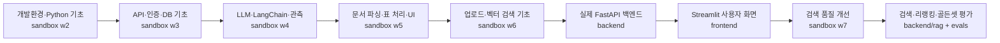

# Hanwha Agent 개발 과정과 코드 이해 안내

이 문서는 저장소의 현재 코드, `sandbox/`의 학습 자료, 프로젝트 가상환경에 설치된 패키지를 함께 보고 지금까지의 개발 흐름을 설명합니다. 파일에 남아 있는 코드와 노트북 주제를 근거로 개발 순서를 재구성했으며, 정확한 작성 날짜나 설치 시점은 기록이 확인되지 않으면 추정하지 않았습니다.

## 1. 프로젝트를 만든 순서

저장소는 실습에서 배운 기술을 한 번에 앱으로 만든 형태라기보다, 작은 주제별 실습을 거쳐 백엔드의 데이터·API 구조를 만들고 화면과 문서 RAG 기능을 단계적으로 연결한 형태입니다. `sandbox/`에는 해당 과정을 익힌 노트북과 샘플이 남고, 실제 앱 코드는 `backend/`, `frontend/`에 모입니다.



이 도식은 저장소의 주제와 코드 구성을 바탕으로 정리한 학습·개발 흐름입니다. 모든 파일이 반드시 이 순서대로 작성되었다는 커밋 이력 주장은 아닙니다.

## 2. 단계별로 무엇을 익히고 앱에 반영했나

### 2.1 1단계 — Python 프로젝트와 개발 환경 (`sandbox/w2`)

초기 자료에는 프로젝트 구조, 타입 힌트와 Pydantic, 환경 변수, 예외, 로깅, pytest 실습이 있습니다. 이 단계에서 앱 설정과 입력·출력 계약을 코드로 표현하는 기초를 익힌 뒤 백엔드의 다음 구성으로 이어집니다.

- `backend/app/core/config.py`: Pydantic Settings 기반 환경 설정
- `backend/app/core/exceptions.py`: 애플리케이션 예외 종류와 상태 코드
- `backend/app/core/logging.py`: 로깅 초기화와 로거 생성
- `backend/app/schemas/`: 요청·응답 데이터 검증
- `backend/tests/`: pytest 테스트 구조

### 2.2 2단계 — DB와 API 서버, 인증 기초 (`sandbox/w3` 및 `backend` 초기 구조)

실습 파일에는 PostgreSQL, 비동기 개념, API 호출, 로그인·비밀번호 검증, Repository 패턴, 가드 함수 주제가 보입니다. 앱에서는 SQLAlchemy 모델과 Repository/Service/API 계층으로 구체화했습니다.

- `models/`는 Department, User, Document, DocumentVersion 등 DB 엔티티를 정의합니다.
- `repositories/`는 SQLAlchemy 세션을 받아 사용자·문서 조회와 저장을 담당합니다.
- `services/`는 업무 순서와 트랜잭션을 구성합니다.
- `api/v1/`는 HTTP 경로와 요청·응답 모델을 서비스에 연결합니다.
- `core/security.py`, `auth_service.py`는 비밀번호 해시 확인을 포함한 로그인 흐름을 둡니다.
- `db/session.py`, `db/init_db.py`, `db/seed.py`는 DB 연결, 테이블 준비, 초기 데이터 적재를 담당합니다.

계층을 나눈 핵심 목적은 HTTP 세부사항, 업무 규칙, DB 쿼리를 서로 분리하는 것입니다. 예를 들어 문서 목록은 라우터가 파라미터를 받고, 서비스가 결과 변환을 조정하고, Repository가 쿼리를 수행합니다.

### 2.3 3단계 — LLM 호출과 응답 구조화 (`sandbox/w4`)

샌드박스 주제에는 API 첫 호출, 사용량, LangChain, 비동기 호출, Langfuse가 포함됩니다. 실제 앱은 LLM 호출을 서비스에서 직접 SDK로 고정하지 않고 포트와 어댑터 구조로 감쌌습니다.

- `integrations/ports.py`: `LLMPort`, `LLMResult` 등 외부 연동 계약 정의
- `integrations/llm_claude.py`: Claude API 어댑터
- `integrations/factory.py`: 설정을 기준으로 LLM·임베딩 구현 선택
- `agent/chain.py`: 프롬프트를 Runnable 체인으로 조합
- `agent/prompts/answer_system.md`: 답변 지침 프롬프트
- `services/chat_service.py`: 질문 검증, Run/Usage 기록, 출력 JSON 검증과 재시도
- `integrations/langfuse_client.py`: 선택적 trace·score 연동

이 구조에서는 서비스가 `LLMPort` 계약만 사용하고 구체적 모델 연결은 `factory`가 선택합니다. 따라서 테스트에서 팩토리를 대체하거나, 포트 계약을 만족하는 새 어댑터를 추가하기 쉽습니다. 단, 현재 팩토리는 live가 아닌 모드용 mock LLM을 제공하지 않고 오류를 반환합니다.

### 2.4 4단계 — 여러 문서 형식과 표 처리 (`sandbox/w5`)

샌드박스의 자료와 샘플에는 HWPX, PDF, DOCX 파싱, 표를 Markdown으로 변환, 임베딩 비교, 화면 구성 실험이 있습니다. 실제 앱에서는 파서가 원본 형식별 결과를 공통 `ParsedDoc` 구조로 바꾸고, 청커와 임베더는 그 공통 구조를 사용합니다.

- `integrations/ports.py`의 `ParsedBlock`, `ParsedDoc`: 파서 출력 계약
- `rag/local_parsers.py`: DOCX/PDF/HWPX/XLSX/PPTX 로컬 파싱 코드
- `rag/parser.py`: 파일 형식에 따른 파서 분기
- 표는 Markdown 텍스트로 만들어 독립 블록으로 유지합니다.
- 테스트 샘플과 실험 파일은 `sandbox/`에 있고, 앱 로직은 `backend/app/rag/`에 있습니다.

주의할 점은 파서가 처리할 수 있는 확장자와 업로드 API가 허용하는 확장자가 다르다는 것입니다. 현재 문서 업로드 API는 `.docx`, `.pdf`만 허용합니다. 파서에 추가 구현이 존재한다고 API 업로드가 자동으로 해당 형식을 허용하는 것은 아닙니다.

### 2.5 5단계 — 문서 업로드, 청킹과 벡터 적재 (`sandbox/w6`, 현재 백엔드)

샌드박스에는 업로드와 임베딩 실험, HNSW 설명 코드가 있습니다. 제품 경로는 업로드한 원본을 저장하고, 백그라운드 작업에서 파싱·청킹·임베딩 후 버전별 청크를 DB에 기록하는 구조입니다.

```text
문서 업로드 API
  → 파일 형식 검사 및 uploads/에 원본 저장
  → Document / DocumentVersion 등록
  → BackgroundTasks 작업 생성
  → parser.parse()로 ParsedDoc 구성
  → chunker.chunk()로 조항·표 청크 생성
  → embedder.embed_documents()로 벡터 생성
  → store.save_chunks()로 청크와 벡터 저장
  → 버전 인덱스 상태 완료로 갱신
```

초기 검색 기반은 `rag/store.py`의 cosine distance 벡터 검색과 `rag/policy.py`의 현행 버전·보안 등급 필터입니다. 이후 `retriever.py`, `reranker.py`가 추가되어 검색 후보를 확장·결합·재정렬하는 기능으로 발전했습니다. 다만 현재 `chat_service.ask()`는 `LiveRetriever`를 호출하지 않고 빈 `NO_CONTEXTS`로 체인을 구성합니다. 따라서 검색·평가 경로가 구현되어 있어도 채팅 API 경로와 검색은 아직 연결되지 않은 상태입니다.

### 2.6 추가 단계 — 검색 결과 개선과 품질 측정 (`sandbox/w7`, `backend/app/rag`, `evals/`)

`sandbox/w7/`에는 골든셋, Multi-Query/하이브리드 재측정, 리랭킹 실험이 추가되었습니다. 실험 내용을 앱 코드로 옮겨 현재 검색 경로를 다음처럼 구성했습니다.

```text
질문
  → 동의어를 덧붙인 Multi-Query 생성
  → 각 질문을 임베딩해 벡터 후보 검색
  → 원 질문으로 BM25 키워드 검색 (선택)
  → RRF 순위 합치기
  → 버전·보안 등급 정책 필터
  → 간이 리랭킹 또는 로컬 Cross Encoder
  → 점수 임계값 확인 및 근거 출처 반환
```

`evals/run_eval.py`는 골든셋의 기대 문서·버전·종류·키워드와 검색 결과를 비교합니다. 기본 벡터 검색, Multi-Query, 하이브리드 검색 구성을 비교하고 JSON 리포트와 DB 평가 기록을 저장하도록 되어 있습니다. 골든셋은 `evals/reports/golden_set.yaml`, 결과는 `evals/reports/`에 둡니다. 실행 예시는 `python evals/run_eval.py --config "기본 검색"`입니다. 평가를 실행하려면 DB에 색인된 청크와 임베딩 모델을 사용할 수 있어야 합니다.

### 2.7 UI와 백엔드 API 연결 (`frontend/`)

프론트엔드는 Streamlit으로 구성했습니다. 화면은 API를 직접 호출하지 않고 공통 클라이언트를 통합니다.

```text
frontend/app.py
  → 로그인 여부 확인 (frontend/core/session.py)
  → 화면 키 확인 (frontend/core/router.py)
  → views 화면 렌더링
  → core/api_client.py에서 FastAPI 요청
  → API JSON을 화면에 표시
```

주요 화면:

- `views/login.py`: 사번·비밀번호 로그인
- `views/documents.py`: 목록, 필터, 지표, 상세 진입
- `views/document_upload.py`: 업로드 폼과 작업 상태 폴링
- `views/docurment_detail.py`: 문서 버전 상세 표시
- `views/chat.py`: 질문 입력과 답변 표시

공통 UI는 `ui/` 아래 카드, 표, 뱃지, 상태 표시, 차트 등으로 분리되어 있습니다. 사용자 정보와 화면 상태는 Streamlit `session_state`를 사용합니다. `api_client.py`는 `API_BASE_URL`을 기준으로 백엔드에 HTTP 요청을 보내고 연결·시간 초과·HTTP 오류를 `ApiError`로 바꿔 화면에서 보여줍니다.

## 3. 폴더별 코드를 읽는 순서

### Backend를 이해할 때

처음부터 모든 파일을 읽기보다 한 요청을 따라가면 각 계층의 역할이 선명합니다.

1. **진입점** — `backend/app/main.py`: 앱 생성, 초기화, 라우터 연결
2. **API 계약** — `backend/app/api/v1/`와 `backend/app/schemas/`: URL, 파라미터, 응답 형태
3. **업무 처리** — `backend/app/services/`: 요청 처리 순서, 예외, 트랜잭션
4. **DB 쿼리** — `backend/app/repositories/`: 조회·저장
5. **데이터 구조** — `backend/app/models/`: 테이블과 관계
6. **외부 연동** — `backend/app/integrations/`: 포트, 어댑터, 팩토리
7. **문서 파이프라인** — `backend/app/rag/`: 파서→청커→임베더→저장·검색
8. **평가·개발 실험** — `evals/`, `sandbox/w7/`: 검색 결과 품질을 기준 데이터로 비교
9. **테스트** — `backend/tests/`: 각 기능의 기대 동작과 계층 경계

예시로 업로드를 읽을 때는 `api/v1/documents.py → services/document_service.py → rag/parser.py → rag/chunker.py → rag/embedder.py → rag/store.py → models/document.py` 순서로 따라갑니다. 검색은 `rag/retriever.py → rag/store.py → rag/policy.py → rag/reranker.py → integrations/local_rerank.py` 순서로 읽고, 평가 연결은 `evals/run_eval.py → evals/reports/golden_set.yaml`로 봅니다. 채팅은 `api/v1/chat.py → services/chat_service.py → agent/chain.py → integrations/factory.py → integrations/llm_claude.py` 순서로 보면 됩니다. 현재 채팅 경로가 `retriever.py`와 연결되지 않았다는 점에 유의합니다.

### Frontend를 이해할 때

1. `frontend/app.py`에서 앱 진입과 화면 분기를 확인합니다.
2. `frontend/core/session.py`, `router.py`에서 사용자·페이지 상태를 봅니다.
3. 원하는 화면의 `frontend/views/*.py`에서 사용자 이벤트와 데이터 표시를 읽습니다.
4. 화면이 호출하는 `frontend/core/api_client.py` 함수에서 URL, HTTP 방식, 헤더와 본문을 확인합니다.
5. 공통 표시 로직은 `frontend/ui/`와 CSS는 `frontend/asset/`에서 살펴봅니다.

예를 들어 업로드 화면은 `views/document_upload.py → api_client.upload_document() → POST /api/v1/documents`로 요청을 보내고, 받은 job ID로 상태 조회를 반복합니다.

### Sandbox를 이해할 때

`sandbox/`는 제품 코드와 섞이지 않도록 주차·일자별 학습 실험을 보관하는 영역입니다. 하위 폴더 이름은 대략 다음 주제 흐름을 보여줍니다.

| 경로 | 주요 학습 주제(파일명 기준) |
|---|---|
| `sandbox/w2/` | Python 기초, 타입·Pydantic, 환경 설정, DB/Repository, pytest |
| `sandbox/w3/` | 로그인·비밀번호 검증, PostgreSQL, API 호출, 가드, 비동기 |
| `sandbox/w4/` | LLM/API, LangChain, 사용량, Langfuse |
| `sandbox/w5/` | 문서 파싱, HWPX, DOCX/PDF, 표 추출, Markdown 변환, 임베딩 비교, 화면 실험 |
| `sandbox/w6/` | 업로드, 임베딩, HNSW 개념·실험 |
| `sandbox/w7/` | 골든셋 평가, Multi-Query·하이브리드 검색 비교, 리랭킹 실험 |
| `sandbox/streamlit/` | Streamlit 위젯, 레이아웃, 탐색, 차트, 채팅·업로드 초기 실험 |
| `sandbox/pytest/` | pytest fixture와 import 등 작은 실험 |

실험을 찾을 때는 관련 노트북에서 아이디어가 어떻게 검증되었는지 보고, 현재 동작을 확인할 때는 `backend/` 또는 `frontend/`의 앱 코드를 기준으로 합니다. 노트북은 일부 학습 코드나 오래된 설계를 포함할 수 있어 현재 제품 흐름의 증거로 그대로 취급하지 않습니다.

## 4. 설치 라이브러리와 사용 목적

### 의존성 기록 방식

현재 `pyproject.toml`에는 pytest의 `pythonpath`와 테스트 경로 설정만 있습니다. 애플리케이션 의존성을 선언한 `requirements.txt`나 `project.dependencies` 목록은 확인되지 않았습니다. 아래 “설치된 패키지”는 저장소의 `.venv`에서 조회한 시점의 `pip freeze` 결과이며, 프로젝트가 의도적으로 고정한 공식 의존성 명세와는 다릅니다. 노트북에는 일부 설치 명령이 따로 남아 있습니다.

### 앱 기능에 직접 연관된 주요 패키지

| 패키지 | 사용 영역 |
|---|---|
| FastAPI, Uvicorn | 백엔드 HTTP API 및 ASGI 서버 |
| Streamlit | 프론트엔드 화면과 상호작용 |
| Pydantic, pydantic-settings | API 입력·출력 검증 및 환경 설정 |
| SQLAlchemy, Alembic | ORM, DB 세션·모델, 스키마 마이그레이션 |
| pgvector, psycopg | PostgreSQL 벡터 컬럼·연결 |
| python-multipart | FastAPI multipart 파일 업로드 처리 |
| httpx, httpx2 | 프론트 API HTTP 요청 라이브러리(현재 API 클라이언트 코드는 `httpx2`를 import) |
| python-dotenv | `.env` 설정을 읽는 보조 경로 |
| LangChain Core, langchain-text-splitters | 프롬프트 Runnable 구성 및 긴 청크 분할 |
| rank-bm25 | 선택적 BM25 키워드 검색 |
| anthropic, langchain-anthropic | Claude SDK 및 LangChain 연동 기반 |
| langfuse | LLM 호출 추적·점수 기록 연동 |
| sentence-transformers, transformers, torch | 로컬 임베딩 모델 실행 기반 |
| huggingface-hub, tokenizers, safetensors | 모델 내려받기 및 모델 파일·토큰 처리 기반 |
| pypdf, pdfplumber, pdfminer.six | PDF 텍스트 및 표 추출 |
| python-docx, lxml | DOCX 문서 구조 및 표 처리 |
| openpyxl, XlsxWriter | XLSX 읽기·쓰기 및 표 영역 처리 |
| python-pptx | PPTX 텍스트·표·차트 처리 |
| pytest | 테스트 실행 |
| Jupyter, ipykernel, ipywidgets | 노트북 기반 실습과 인터랙티브 실험 |

이 표는 소스 import와 가상환경 패키지 목록을 바탕으로 용도를 요약한 것입니다. 패키지가 설치돼 있다는 이유만으로 모든 패키지가 현재 API 실행 경로에서 사용된다는 뜻은 아닙니다. 예컨대 일부 파서는 업로드 API가 아직 허용하지 않는 확장자도 처리할 수 있습니다.

### 노트북에 기록된 설치 명령

코드 검색으로 확인되는 설치 지시는 다음과 같습니다.

- `sandbox/w2/day01/02.환경변수설정.ipynb`: `pydantic-settings`
- `sandbox/w2/day02/03.로깅.ipynb`: `pytest`
- `sandbox/w5/day04/00.문서형식확장.ipynb`: `openpyxl==3.1.5`, `python-pptx==1.0.2`
- `sandbox/w6/day01/00.업로드01.ipynb`: `ipywidgets`, `jupyter`, `ipykernel` 업그레이드
- `sandbox/w5/day02/download_models.py`: `huggingface-hub`, `sentence-transformers` 설치를 위한 안내문
- `download_reranker.py`: 리랭커 모델 다운로드에 필요한 `huggingface-hub>=1.5,<2` 설치 안내

설치 명령이 노트북에 있다는 사실은 기록했지만, 그 명령을 실제로 어느 날짜에 어떤 환경에서 실행했는지는 단정하지 않습니다. 또한 현재 `.venv`에서 보이는 버전과 노트북에 적힌 버전이 다를 수 있습니다.

## 5. 개발·실행 환경을 이해하는 데 중요한 파일

- `pyproject.toml`: 현재 pytest 검색 경로 및 테스트 위치 설정
- `.gitignore`: `.venv/`, `.env`, DB 파일, 캐시, `sandbox/` 등 Git 제외 패턴
- `docker-compose.yml`: PostgreSQL/pgvector와 선택적 Langfuse 컨테이너
- `backend/app/core/config.py`: DB URL, LLM·임베딩 제공자, 검색 설정 등의 기본값 및 환경 설정
- `backend/app/db/session.py`: 실제 DB URL로 엔진·세션 구성
- `backend/app/rag/retriever.py`: 질의 확장부터 검색 후보 반환까지의 검색 흐름
- `backend/app/rag/reranker.py`, `backend/app/integrations/local_rerank.py`: 간이·Cross Encoder 리랭킹
- `backend/app/services/eval_service.py`, `backend/app/api/v1/ops.py`: 평가 실행 이력 조회 API
- `backend/app/models/eval.py`: 평가 결과 테이블 모델
- `backend/app/db/migrations/versions/9e1f9253cccb_add_eval_tables.py`: 평가용 DB 테이블 마이그레이션
- `evals/run_eval.py`: 골든셋 평가 CLI
- `evals/reports/golden_set.yaml`: 검색 품질 평가용 질문·정답 데이터
- `evals/reports/eval_*.json`: 평가 실행 결과 리포트
- `download_reranker.py`: 로컬 Cross Encoder 모델 다운로드·확인 도구

`.gitignore`에 `sandbox/`와 `.env`가 제외 대상으로 적혀 있습니다. 이 문서는 비밀 설정을 확인하거나 복사하지 않았으며, 비밀값이나 비밀 키 식별자도 싣지 않습니다. 로컬 `.env`는 공유 문서·로그·스크린샷에 포함하지 마세요.

## 6. 현재 구현을 읽을 때 기억할 점

1. `backend/main.py`의 간단한 health 앱과 실제 API 앱 `backend/app/main.py`는 별도 진입점입니다.
2. 문서 업로드는 메타데이터·원본 저장 이후 백그라운드 적재 작업으로 이어집니다.
3. 작업 진행 상태는 현재 프로세스 메모리에 있으므로 영속 작업 큐와는 다릅니다.
4. 검색기는 Multi-Query·벡터/BM25 하이브리드·RRF·정책 필터·리랭킹을 지원하고 별도의 골든셋 평가도 있습니다. 채팅 서비스는 아직 검색 결과를 프롬프트 컨텍스트에 넣지 않습니다.
5. 채팅 서비스는 실제 로그인 사용자 대신 고정 임시 사용자 정보를 사용합니다.
6. 설정 기본값은 SQLite와 local 임베딩이며, LLM 팩토리는 live 모드가 아니면 mock 대신 오류를 냅니다.
7. `sandbox/` 자료는 학습 및 실험 참고용이고, 현재 제품 구현의 기준은 앱 코드입니다.
8. 런타임 의존성 전체가 프로젝트 설정 파일에 선언되지 않았으므로, 새 환경에서도 재현 가능하게 하려면 별도 dependency manifest를 유지할 필요가 있습니다.

## 7. 전체 내용을 한 줄로 연결

**Python·API·DB 기초를 `sandbox/`에서 익히고, `backend/`에 API·문서 적재·검색·리랭킹·평가를 구현한 뒤 `frontend/`에서 API로 사용하는 프로젝트입니다.** 채팅에 검색 결과와 실제 사용자 권한을 연결하는 통합은 아직 남아 있습니다.

## 8. 처음 설치하는 사람을 위한 pip 설치 목록

현재 프로젝트는 `pyproject.toml`에 실행용 패키지 목록이 선언되어 있지 않습니다. 아래는 소스 코드와 현재 가상환경을 참고해 기능별로 다시 만든 설치 명령입니다. 새로운 Python 가상환경을 만든 뒤 Windows PowerShell에서 순서대로 실행하면 됩니다. `.env`의 값은 이 안내에 복사하지 마세요.

### 8.1 가상환경 만들기

```powershell
cd C:\HongStd\hanwha-agent
py -m venv .venv
.\.venv\Scripts\Activate.ps1
python -m pip install --upgrade pip
```

PowerShell 실행 정책 때문에 활성화가 막히면 가상환경의 실행 파일을 직접 호출해도 됩니다. 예를 들어 `python -m pip` 대신 `& .\.venv\Scripts\python.exe -m pip install ...`을 실행하면 됩니다.

### 8.2 백엔드·프론트 기본 패키지

```powershell
python -m pip install fastapi uvicorn streamlit httpx2 python-multipart
python -m pip install pydantic pydantic-settings python-dotenv bcrypt
python -m pip install sqlalchemy alembic pgvector psycopg[binary]
```

- FastAPI/Uvicorn은 HTTP API 서버, Streamlit은 화면, `httpx2`는 현재 프론트 API 클라이언트가 import하는 HTTP 클라이언트입니다.
- Pydantic 패키지는 API 스키마와 환경 설정, multipart 패키지는 업로드 요청에 쓰입니다.
- SQLAlchemy/Alembic은 DB 모델과 스키마 변경, pgvector와 psycopg는 PostgreSQL 벡터 타입 및 연결에 쓰입니다.
- 기본 설정은 SQLite지만 모델의 벡터 컬럼과 PostgreSQL 운영 경로를 사용할 때는 PostgreSQL/pgvector 환경도 필요합니다. `docker-compose.yml`은 DB 컨테이너를 정의합니다.

### 8.3 문서 파싱 패키지

```powershell
python -m pip install pypdf pdfplumber python-docx openpyxl python-pptx lxml
```

PDF 표 추출, DOCX 문단·표 읽기, XLSX 시트 처리, PPTX 텍스트·차트·표 읽기에 사용합니다. HWPX 파서는 Python 표준 라이브러리의 ZIP/XML 기능도 사용합니다. PDF 표 파싱이 필요하지 않다면 `pdfplumber`는 선택 패키지로 둘 수 있지만, 현재 코드가 해당 옵션 경로를 지원합니다.

### 8.4 청킹·LLM·관측 패키지

```powershell
python -m pip install langchain-core langchain-text-splitters anthropic langfuse
```

LangChain Core는 프롬프트·Runnable 연결, text splitters는 긴 텍스트 분할, Anthropic은 Claude 어댑터, Langfuse는 선택적 추적 기능에 사용됩니다. Langfuse를 사용하지 않더라도 현재 서비스는 관련 모듈을 import하므로 패키지를 설치하는 편이 안전합니다.

### 8.5 로컬 임베딩 패키지 (선택)

```powershell
python -m pip install sentence-transformers
```

`sentence-transformers`가 Torch·Transformers 등 필요한 하위 패키지를 함께 설치합니다. 이 그룹은 로컬 임베딩 모델을 실행할 때 필요합니다. 모델 파일은 별도 다운로드가 필요할 수 있으며, 저장소의 `sandbox/w5/day02/download_models.py`에 모델 준비 절차가 있습니다. GPU/CUDA가 필요한 환경은 장치에 맞는 PyTorch 설치 방법을 별도로 확인해야 합니다.

### 8.6 하이브리드 검색·Cross Encoder 모델 (선택)

```powershell
python -m pip install rank-bm25 "huggingface-hub>=1.5,<2"
```

`rank-bm25`가 설치되어 있으면 `store.keyword_search()`가 BM25 키워드 검색을 수행합니다. 설치하지 않으면 하이브리드 검색에서 키워드 부분을 경고와 함께 건너뛰고 벡터 후보만 사용합니다. `huggingface-hub`는 Cross Encoder 가중치를 받을 때 사용합니다. 가중치 파일은 별도 폴더에 저장되며 크기가 크므로 디스크 여유 공간을 확인하세요. 저장소 루트의 `download_reranker.py`에 다운로드·파일 확인·smoke 실행 명령이 적혀 있습니다.

### 8.7 테스트 및 노트북 패키지 (선택)

```powershell
python -m pip install pytest
python -m pip install jupyter ipykernel ipywidgets
```

`pytest`는 `backend/tests/` 실행에, Jupyter 그룹은 `sandbox/` 노트북 실습에 사용됩니다. UI 실험용 `streamlit-aggrid`, `streamlit-echarts`, `streamlit-shadcn-ui`는 현재 화면에서 사용하는 컴포넌트가 필요할 때 추가합니다.

```powershell
python -m pip install streamlit-aggrid streamlit-echarts streamlit-shadcn-ui
```

### 8.8 한 번에 설치하는 명령

아래는 앱의 주요 기능(백엔드, 프론트, DB, 파서, LLM, 로컬 임베딩, 테스트)을 모두 준비하는 단일 명령입니다. PyTorch 계열은 크기가 크므로 로컬 임베딩이 필요하지 않으면 `sentence-transformers`를 빼고 설치하세요.

```powershell
python -m pip install fastapi uvicorn streamlit httpx2 python-multipart pydantic pydantic-settings python-dotenv bcrypt sqlalchemy alembic pgvector "psycopg[binary]" pypdf pdfplumber python-docx openpyxl python-pptx lxml langchain-core langchain-text-splitters rank-bm25 anthropic langfuse sentence-transformers "huggingface-hub>=1.5,<2" pytest
```

### 8.9 설치 확인과 앱 실행 예

```powershell
python -m pip check
python -m pytest
```

테스트 명령은 `pyproject.toml`의 pytest 설정을 이용합니다. API와 Streamlit은 각각 별도 터미널에서 실행합니다.

```powershell
python -m uvicorn app.main:app --app-dir backend --reload
```

```powershell
python -m streamlit run frontend/app.py
```

DB에 PostgreSQL을 쓸 경우 API 실행 전에 Compose로 DB를 띄우고, 비밀 값이 아닌 DB 연결 설정을 로컬 환경에 맞춰야 합니다. LLM live 호출·Upstage API·Langfuse를 켜려면 별도의 로컬 비밀 설정이 필요하지만, 키 이름과 값은 이 학습 문서에 기록하지 않습니다.

> 설치 재현성을 높이려면 의존성을 검증한 뒤 `requirements.txt` 또는 `[project.dependencies]`에 의도한 버전을 기록하는 것이 좋습니다. 현재 설치 목록은 `.venv`의 관찰 결과를 토대로 재구성한 것이며, 이 명령 자체를 새 환경에서 실행해 호환성을 검증하지는 않았습니다.

## 9. 파일을 어떤 순서로 공부할까

아래 순서는 “화면에서 요청을 발생시키고, 백엔드가 처리해 결과를 돌려주는 흐름”을 따라가도록 구성했습니다. 각 파일은 전부 암기하기보다 먼저 호출 관계를 잡고, 함수의 입력과 반환값을 확인하세요.

### 9.1 먼저 계약과 기본 용어

1. `backend/app/schemas/` — API가 받을 입력과 돌려줄 출력의 모양
2. `backend/app/models/base.py` — SQLAlchemy 모델의 공통 기반과 타임스탬프
3. `backend/app/models/org.py` — 부서, 사용자, 보안 등급
4. `backend/app/models/document.py` — 문서, 버전, 청크, 임베딩
5. `backend/app/models/run.py`, `usage.py` — 채팅 실행 기록과 사용량
6. `backend/app/integrations/ports.py` — 파서·LLM·임베더 사이에서 주고받는 표준 데이터

### 9.2 서버와 DB를 이해하기

1. `backend/app/core/config.py` — 환경 설정을 `Settings` 객체로 제공
2. `backend/app/db/session.py` — DB 엔진, 세션 팩토리, `session_scope()`
3. `backend/app/db/init_db.py` — 테이블 생성 진입 함수
4. `backend/app/db/seed_data.py`, `seed.py` — 초기 부서·사용자·문서 데이터 준비
5. `backend/app/main.py` — lifespan에서 로깅, DB 초기화, 시드 후 라우터 등록
6. `backend/app/core/exceptions.py`, `main.py` 예외 핸들러 — 도메인 오류를 HTTP 오류 응답으로 변환
7. `backend/app/db/migrations/` — Alembic 환경과 변경 이력

### 9.3 문서 목록 조회 API를 따라가기

1. `frontend/views/documents.py`의 `render()` — 페이지를 그리고 필터를 읽음
2. `frontend/core/api_client.py`의 `list_documents()` — GET 요청을 만듦
3. `backend/app/api/v1/documents.py`의 `list_documents()` — HTTP 파라미터를 받음
4. `backend/app/services/document_service.py`의 `list_documents()` — 세션과 Repository 연결
5. `backend/app/repositories/document_repo.py`의 `list_documents()` — DB 쿼리 구성
6. `document_service._to_out()` — ORM 객체를 응답용 dict로 변환
7. `backend/app/schemas/document.py`의 `DocumentOut` — 응답 모양 검증
8. 화면의 `_table()` — JSON 응답을 UI 표로 렌더링

### 9.4 문서 업로드와 색인을 따라가기

1. `frontend/views/document_upload.py`: `_render_form()`에서 입력값을 받고 업로드 요청
2. `frontend/core/api_client.py`: `upload_document()`가 multipart 요청을 보냄
3. `backend/app/api/v1/documents.py`: `upload_document()`가 확장자 검사, 파일 저장, 서비스 호출
4. `backend/app/services/document_service.py`: `create_document()`가 문서와 버전 등록
5. 같은 서비스 파일의 `start_ingest_job()`이 작업 상태를 만들고 라우터가 BackgroundTasks에 실행을 맡김
6. `run_ingest_job()` → `ingest_document()`가 적재 전체를 수행
7. `backend/app/rag/parser.py`: `parse()`로 파서 선택
8. `backend/app/rag/local_parsers.py`: 형식별 파싱 함수가 `ParsedDoc` 생성
9. `backend/app/rag/chunker.py`: `chunk()`가 텍스트 블록을 검색용 청크로 나눔
10. `backend/app/rag/embedder.py`: `embed_documents()`가 청크를 벡터화
11. `backend/app/integrations/factory.py`: `get_embedder()`가 로컬/Upstage 구현을 선택
12. `backend/app/rag/store.py`: `save_chunks()`가 DB에 저장
13. `frontend/views/document_upload.py`의 `_render_progress()`가 `get_job()`으로 상태를 폴링

### 9.5 채팅을 따라가기

1. `frontend/views/chat.py`의 `render()` — 질문 입력과 답변 표시
2. `frontend/core/api_client.py`의 `ask()` — POST 요청
3. `backend/app/api/v1/chat.py`의 `create_message()` — `ChatRequest`를 서비스로 전달
4. `backend/app/services/chat_service.py`의 `ask()` — 가드, LLM 선택, Run 생성, 응답 검증·재시도, 사용량 및 Run 저장
5. `backend/app/core/guards.py`의 `check_question()` — 질문 검사와 정리
6. `backend/app/integrations/factory.py`의 `get_llm()` — LLM 구현 선택
7. `backend/app/agent/chain.py`의 `build_result_chain()` — 프롬프트와 LLM 포트를 연결
8. `backend/app/integrations/llm_claude.py`의 `ClaudeLLM.answer()` — 외부 LLM 호출과 결과 메타데이터 구성
9. 다시 `chat_service.ask()`에서 `_extract_json()`과 `AnswerOut`으로 결과를 확인
10. `backend/app/api/v1/chat.py`가 JSON 결과를 반환하고 프론트가 답변을 표시

현재 단계에서 `chat_service.ask()`는 문서 검색 결과 대신 빈 contexts를 넣습니다. 검색 기능을 공부할 때는 `rag/embedder.embed_query()` → `rag/store.vector_search()` → `rag/policy.filter_candidates()` 경로를 별도로 읽고, 이 경로가 채팅 서비스에는 아직 연결되지 않았음을 함께 기억하세요.

## 10. 주요 함수 사전

여기서 “함수”는 `def`로 정의한 동작 단위, “클래스”는 여러 데이터나 동작을 묶는 설계도입니다. 이름 앞의 밑줄(`_to_out`, `_request`)은 보통 해당 파일 안에서 쓰는 내부 보조 함수라는 표시입니다. 타입 힌트는 입력·반환값의 기대 형태를 설명하며, 런타임 검증은 Pydantic 같은 코드가 실제로 수행합니다.

### Backend 앱·공통 기능

| 파일 | 함수/클래스 | 쉬운 설명 |
|---|---|---|
| `backend/app/main.py` | `lifespan()` | 앱 시작 때 로깅·DB·초기 데이터를 준비하고 서버가 요청을 받게 함 |
| 같은 파일 | `health()` | 서버가 응답 가능한지 간단한 상태를 돌려줌 |
| 같은 파일 | `agent_error_error()` | 업무 예외를 공통 JSON 오류로 바꿈 |
| 같은 파일 | `handle_validation_error()` | 요청 필드 검증 오류를 422 응답으로 바꿈 |
| `core/config.py` | `Settings` | 앱 설정 항목과 기본값·검증 규칙을 정의 |
| 같은 파일 | `get_settings()` | 설정 객체를 캐시해 제공 |
| 같은 파일 | `mask()` | 문자열을 일부만 보이게 마스킹하는 보조 함수 |
| `core/security.py` | `hash_password()` | 원문 비밀번호를 안전한 해시로 변환 |
| 같은 파일 | `verify_password()` | 입력 비밀번호가 저장 해시와 맞는지 확인 |
| `core/guards.py` | `check_question()` | 질문을 정리하고 길이·형식 제한을 검사 |
| 같은 파일 | `check_model()` | 허용된 모델명인지 검사 |
| 같은 파일 | `check_daily_limit()` | 일일 사용 한도를 넘었는지 검사 |
| `core/logging.py` | `setup_logging()` | 로그 출력 형식과 레벨을 설정 |
| 같은 파일 | `get_logger()` | 모듈별 로거를 가져옴 |
| `core/exceptions.py` | `AgentError` 및 하위 예외들 | 찾을 수 없음, 인증 실패, 입력 오류, 외부 연동 실패 등을 구분 |

### DB·초기 데이터·Repository

| 파일 | 함수 | 쉬운 설명 |
|---|---|---|
| `db/session.py` | `get_engine()` | DB URL에 맞는 SQLAlchemy 엔진을 만들고 재사용 |
| 같은 파일 | `get_sessionmaker()` | DB 작업 세션을 만드는 공장을 반환 |
| 같은 파일 | `session_scope()` | 세션을 열고 성공 시 커밋, 오류 시 롤백, 종료 시 닫음 |
| `db/init_db.py` | `init_db()` | 모델 정의를 바탕으로 테이블을 준비 |
| 같은 파일 | `main()` | DB 초기화를 단독 스크립트로 실행하는 진입점 |
| `db/seed.py` | `count_rows()` | 주요 테이블의 데이터 수를 확인 |
| 같은 파일 | `seed_all()` | 초기 데이터 적재를 시작하고 결과 수를 반환 |
| 같은 파일 | `_seed()` | 부서·사용자·문서 등 실제 초기 레코드를 생성 |
| `repositories/user_repo.py` | `get_by_emp_no()` | 사번으로 사용자 한 명을 조회 |
| `repositories/document_repo.py` | `list_documents()` | 필터 조건으로 문서와 버전을 조회 |
| 같은 파일 | `get_document()` | 문서 ID로 한 건을 조회 |
| 같은 파일 | `add_version()` | 문서에 새 버전 레코드를 추가 |
| `services/ids.py` | `next_run_id()` | 다음 채팅 실행 식별자를 생성 |

### 인증·문서·채팅 서비스

| 파일 | 함수 | 쉬운 설명 |
|---|---|---|
| `services/auth_service.py` | `_to_out()` | 사용자 DB 객체에서 응답에 필요한 정보만 골라냄 |
| 같은 파일 | `authenticate()` | 사번 조회와 비밀번호 검증 후 사용자 정보를 돌려줌 |
| 같은 파일 | `get_me()` | 사번으로 사용자 정보를 찾아 돌려줌 |
| `services/document_service.py` | `_to_out()` | 문서와 버전 객체를 화면/API 응답용 dict로 변환 |
| 같은 파일 | `list_documents()` | Repository에서 목록을 가져와 응답 데이터로 변환 |
| 같은 파일 | `get_document()` | 문서의 현행 버전을 찾아 반환 |
| 같은 파일 | `create_document()` | 새 문서/버전을 저장하고 이전 현행 버전을 만료 처리 |
| 같은 파일 | `list_versions()` | 문서 버전을 최신 순으로 반환 |
| 같은 파일 | `ingest_document()` | 파싱→청킹→임베딩→청크 저장을 한 번에 조정 |
| 같은 파일 | `start_ingest_job()` | 메모리 작업 목록에 새 적재 작업을 등록 |
| 같은 파일 | `run_ingest_job()` | 작업 상태를 진행/완료/실패로 갱신하며 적재 실행 |
| 같은 파일 | `start_reindex_job()` | 저장된 원본 파일로 기존 버전을 다시 적재하도록 준비 |
| 같은 파일 | `get_job()` | 작업 ID의 진행 상태를 돌려줌 |
| `services/chat_service.py` | `_hint_from()` | Pydantic 검증 오류를 다음 LLM 요청에 넣을 짧은 힌트로 만듦 |
| 같은 파일 | `_fallback()` | 반복 검증 실패 때 사용자에게 돌려줄 기본 답변 생성 |
| 같은 파일 | `_record_usage()` | 토큰·모델·비용 정보를 UsageLog에 저장 시도 |
| 같은 파일 | `ask()` | 질문 검증부터 LLM 호출, JSON 검증, 실행 기록까지 수행 |
| 같은 파일 | `get_run()` | 실행 ID에 해당하는 질문·응답·상태 기록을 조회 |
| `services/eval_service.py` | `list_eval_runs()` | 평가 실행 이력을 DB에서 가져와 API 응답 데이터로 변환 |

### API 라우터와 데이터 계약

| 위치 | 함수/클래스 | 쉬운 설명 |
|---|---|---|
| `api/v1/auth.py` | `login()` | 로그인 요청을 인증 서비스로 전달 |
| 같은 파일 | `me()` | 요청 헤더 사번으로 사용자 정보를 요청 |
| `api/v1/documents.py` | `list_documents()` | 목록 필터와 제한값을 서비스에 전달 |
| 같은 파일 | `upload_document()` | 업로드 파일 형식을 확인하고 저장·등록·백그라운드 작업 시작 |
| 같은 파일 | `read_job()` | 업로드 작업 상태 조회 |
| 같은 파일 | `get_document()` | 문서 한 건 조회 |
| 같은 파일 | `list_versions()` | 문서의 모든 버전 조회 |
| 같은 파일 | `reindex_version()` | 문서 버전 재색인 작업 시작 |
| `api/v1/chat.py` | `create_message()` | 질문 요청을 채팅 서비스로 전달 |
| 같은 파일 | `read_run()` | 채팅 실행 기록 조회 |
| `api/v1/ops.py` | `list_eval_runs()` | 평가 실행 이력을 운영용 API로 조회 |
| `schemas/auth.py` | `LoginIn`, `UserOut` | 로그인 입력과 사용자 응답의 필드·타입 정의 |
| `schemas/document.py` | `DocumentOut`, `VersionOut`, `JobOut` 등 | 문서·버전·작업 응답의 필드 정의 |
| `schemas/chat.py` | `ChatRequest`, `AnswerOut`, `AskOut` | 질문 입력과 답변·근거·시도 횟수 응답 정의 |

라우터 함수는 보통 짧게 유지합니다. 화면에서 온 값을 받고 스키마를 적용한 다음 서비스 함수를 호출하는 것이 중심이며, 복잡한 DB 처리나 외부 API 호출은 서비스·Repository·Integration 쪽에 둡니다.

### RAG 파싱·청킹·임베딩·검색

| 파일 | 함수 | 쉬운 설명 |
|---|---|---|
| `rag/parser.py` | `parse()` | 파일 확장자를 보고 평문·HTML·로컬/외부 파서로 분기 |
| 같은 파일 | `_read_text()` | UTF-8 또는 CP949 인코딩으로 텍스트 파일 읽기 |
| 같은 파일 | `_parse_plain()`, `_parse_markdown()`, `_parse_html()` | 텍스트 형식의 내용을 ParsedBlock 목록으로 바꿈 |
| `rag/local_parsers.py` | `parse_local()` | 로컬 파서 핸들러를 고르고 오류·빈 문서를 검사 |
| 같은 파일 | `parse_pdf()`, `parse_pdf_tables()` | PDF 본문 또는 표를 추출 |
| 같은 파일 | `parse_docx()` | DOCX 본문·표를 순서대로 읽음 |
| 같은 파일 | `parse_hwpx()` | HWPX 내부 XML에서 문단·표를 읽음 |
| 같은 파일 | `parse_xlsx()` | 엑셀 시트를 표 영역으로 나누어 읽음 |
| 같은 파일 | `parse_pptx()` | 슬라이드 텍스트·노트·표·차트를 읽음 |
| 같은 파일 | `_table_to_markdown()` | 표 헤더와 행을 Markdown 표 문자열로 만듦 |
| `rag/chunker.py` | `_split_headings()` | 장·절·부칙 제목을 찾아 본문 구간을 분리 |
| 같은 파일 | `_split_articles()` | 조항 제목을 찾아 조 단위로 분리 |
| 같은 파일 | `_hard_wrap()` | 너무 긴 조항을 최대 길이 이하 조각으로 자름 |
| 같은 파일 | `chunk()` | ParsedDoc 전체를 조항·표 청크 목록으로 변환 |
| 같은 파일 | `summarize()` | 생성된 조항·표 청크 수를 사람이 읽는 문자열로 요약 |
| `rag/embedder.py` | `embed_documents()` | 문서 청크 텍스트를 묶음 단위로 벡터화 |
| 같은 파일 | `embed_query()` | 검색 질문 한 개를 벡터화 |
| 같은 파일 | `embed_dim()`, `model_label()` | 벡터 크기와 사용 모델 표기를 제공 |
| `rag/store.py` | `save_chunks()` | 기존 버전 청크를 지우고 새 텍스트와 벡터를 저장 |
| 같은 파일 | `vector_search()` | 질문 벡터와 cosine distance가 가까운 청크를 조회 |
| 같은 파일 | `_row()` | ORM 결과를 검색 결과 dict로 바꿈 |
| 같은 파일 | `keyword_search()` | BM25로 단어가 겹치는 청크를 찾음; `rank-bm25` 미설치 시 이 단계는 건너뜀 |
| 같은 파일 | `fuse()` | 벡터 검색과 키워드 검색의 순위를 RRF 방식으로 합침 |
| 같은 파일 | `vector_scores()` | 합쳐진 후보의 질문 벡터 유사도를 다시 계산 |
| `rag/policy.py` | `wants_past_version()` | 질문이 과거 버전을 요청하는 표현인지 확인 |
| 같은 파일 | `version_allowed()` | 현행/과거 버전 허용 여부 판단 |
| 같은 파일 | `clearance_allowed()` | 사용자 clearance가 문서 등급에 충분한지 판단 |
| 같은 파일 | `filter_candidates()` | 검색 후보를 버전·보안 정책으로 걸러냄 |
| `rag/retriever.py` | `expand_queries()` | 사용자 표현과 규정 표현의 차이를 보완할 검색 질의들을 생성 |
| 같은 파일 | `source_dict()` | 검색 결과를 짧은 인용문을 포함한 출처 데이터로 변환 |
| 같은 파일 | `LiveRetriever.search()` | 다중 질의→벡터/BM25→RRF→정책→리랭킹→임계값 확인을 조정 |
| `rag/reranker.py` | `score()` | 질문 단어 가운데 본문에 있는 낱말 비율 계산 |
| 같은 파일 | `_simple()` | 벡터 유사도와 단어 중복 점수를 섞어 후보에 재점수 부여 |
| 같은 파일 | `_cross_encoder()` | 질문·청크 쌍의 모델 점수를 후보에 부여 |
| 같은 파일 | `rerank()` | 설정된 리랭커로 후보를 정렬하고 상위 결과 선택 |
| 같은 파일 | `judge_gate()` | 최고 점수와 기준값으로 근거 충분 여부 판정 |
| `integrations/local_rerank.py` | `_sigmoid()` | 모델의 원점수를 0~1 범위로 변환 |
| 같은 파일 | `LocalCrossEncoder.__init__()` | 설정한 로컬 리랭커 모델을 읽어 준비 |
| 같은 파일 | `score_pairs()` | 질문과 문서 조각의 관련도 점수를 계산 |

### 외부 연동과 Agent 체인

| 파일 | 함수/클래스 | 쉬운 설명 |
|---|---|---|
| `integrations/ports.py` | `LLMResult` | LLM 답변 텍스트와 사용량·비용 등 결과 데이터 묶음 |
| 같은 파일 | `LLMPort`, `EmbedderPort`, `ParserPort` | 어댑터가 지켜야 할 메서드 규격 |
| 같은 파일 | `ParsedBlock`, `ParsedDoc` | 파싱한 문서 블록과 전체 문서의 공통 구조 |
| `integrations/factory.py` | `get_llm()` | 현재 설정에 맞는 LLM 어댑터를 반환하거나 사용 불가 오류 |
| 같은 파일 | `get_embedder()` | 로컬 또는 Upstage 임베더 반환 |
| 같은 파일 | `get_cross_encoder()` | 로컬 Cross Encoder 리랭커를 만들고 캐시해 반환 |
| `integrations/llm_claude.py` | `ClaudeLLM.answer()` | 프롬프트와 컨텍스트를 Claude API로 보내고 결과 정리 |
| 같은 파일 | `_extract_json()` | LLM 응답 문자열에서 JSON 객체를 찾고 파싱 |
| 같은 파일 | `estimate_cost_krw()` | 토큰 사용량에 기반한 비용 추정 |
| `integrations/upstage.py` | `UpstageParser`, `UpstageEmbedder` | Upstage 문서 파싱·임베딩 API를 포트 형태로 제공 |
| `integrations/local_embed.py` | `LocalEmbedder` | 로컬 임베딩 모델을 로드해 문서·질문 벡터 생성 |
| `integrations/local_rerank.py` | `LocalCrossEncoder` | 질문과 후보 문서 조각의 관련도를 로컬 모델로 계산 |
| `integrations/ports.py` | `RetrievalResult`, `RerankerPort` | 검색 결과 묶음과 리랭커 인터페이스 정의 |
| `integrations/langfuse_client.py` | `trace()`, `score()` | Langfuse 추적 문맥과 점수 기록을 시도 |
| `agent/chain.py` | `load_prompt()` | 프롬프트 Markdown 파일을 읽음 |
| 같은 파일 | `build_prompt()` | 시스템 지침과 질문 입력용 메시지 템플릿을 만듦 |
| 같은 파일 | `build_result_chain()` | 프롬프트를 LLMPort 호출과 연결해 LLMResult를 반환 |
| 같은 파일 | `build_answer_chain()` | LLMResult 중 답변 텍스트만 추출하는 체인을 구성 |
| 같은 파일 | `build_parsed_chain()` | 출력 형식 지침과 Pydantic parser를 붙인 체인 구성 |

## 11. 프론트엔드 함수 사전

| 파일 | 함수 | 쉬운 설명 |
|---|---|---|
| `frontend/app.py` | `main()` | 상태 초기화, 로그인 여부 확인, 현재 페이지 렌더링 |
| 같은 파일 | `render_sidebar()` | 사용자 정보, 로그아웃, 페이지 이동 메뉴 표시 |
| `frontend/core/session.py` | `init_state()` | 세션 상태에 기본 화면·필터 값을 넣음 |
| 같은 파일 | `current_user()`, `is_authenticated()` | 로그인한 사용자와 로그인 여부 확인 |
| 같은 파일 | `login()`, `logout()` | 세션 로그인·로그아웃 상태 전환 |
| 같은 파일 | `emp_no()` | 로그인 사용자 사번 반환 |
| `frontend/core/router.py` | `current_page()` | 현재 페이지 키를 반환 |
| 같은 파일 | `go()` | 다음에 표시할 페이지 키를 세션에 저장 |
| `frontend/core/api_client.py` | `_request()` | 공통 URL·헤더·요청·오류 처리를 수행 |
| 같은 파일 | `login()`, `me()` | 인증 API 호출 |
| 같은 파일 | `list_documents()`, `get_document()`, `list_versions()` | 문서 API 호출 |
| 같은 파일 | `upload_document()`, `get_job()`, `reindex()` | 업로드·작업 조회·재색인 API 호출 |
| 같은 파일 | `ask()` | 질문을 채팅 API로 보내고 답을 받음 |
| 같은 파일 | `stats()` | 목록을 받아 화면 지표를 계산 |
| `views/login.py` | `render()` | 로그인 폼을 표시하고 로그인 처리 |
| `views/documents.py` | `render()` | 문서 관리 페이지 전체를 표시 |
| 같은 파일 | `_metrics_row()`, `_filter_row()`, `_table()` | 지표·필터·문서 표를 각각 그림 |
| 같은 파일 | `_open_detail()` | 선택 문서의 상세 화면으로 이동 |
| `views/document_upload.py` | `render()` | 업로드 폼 또는 작업 진행 화면 선택 |
| 같은 파일 | `_render_form()` | 업로드 입력을 받고 API 호출 |
| 같은 파일 | `_render_progress()` | 작업 상태와 진행 단계를 표시하고 재조회 |
| `views/chat.py` | `render()` | 대화 내역, 질문 입력, API 답변을 표시 |
| `views/docurment_detail.py` | `render()` | 선택 문서와 버전 상세 정보 표시 |
| 같은 파일 | `_version_block()`, `_version_timeline()` | 버전 설명 및 타임라인 렌더링 |
| 같은 파일 | `_actions()`, `_watch_job()` | 재색인 등 작업을 시작하고 결과 상태 확인 |
| `ui/theme.py` | `load_css()`, `inject_css()` | CSS 파일을 읽어 Streamlit 화면에 적용 |
| `ui/card.py`, `table.py`, `badge.py`, `status.py` | 렌더 함수들 | 카드·표·뱃지·상태 표시를 여러 화면에서 재사용 |

## 12. Sandbox 파일을 학습 순서로 활용하기

노트북은 내용이 길어 이 문서에서 모든 셀을 설명하지 않고, 공부 순서와 핵심 연습을 연결합니다.

1. `sandbox/w2/day01/`의 프로젝트 세팅 → 타입 힌트/Pydantic → 환경 변수 순서로 읽습니다.
2. `sandbox/w2/day02/`에서 함수·예외·로깅·pytest를 익히고 `calculator.py`와 테스트를 직접 따라갑니다.
3. `sandbox/w2/day04/`에서 모델 정의 → 세션/CRUD → 조회 → 수정·삭제 순서로 DB 기본기를 봅니다.
4. `sandbox/w2/day05/`에서 Repository 실습을 보고 앱의 `backend/app/repositories/`와 비교합니다.
5. `sandbox/w3/day01/`에서 비동기와 로그인 실습, `day02`에서 PostgreSQL, `day03~04`에서 API 호출, `day05`에서 guard 실습을 봅니다.
6. `sandbox/w4/day01~03/`에서 Langfuse → API/사용량 → LangChain → 비동기 적용 흐름을 살펴봅니다.
7. `sandbox/w5/day01~02/`에서 파싱·표 변환 → 형식 분기와 차단 → HWPX를 공부합니다.
8. `sandbox/w5/day03~05/`에서 화면·임베딩 비교·상용 API·다양한 표 파일 테스트 자료를 봅니다.
9. `sandbox/w6/day01~03/`에서 업로드 → 임베딩 → HNSW → 문서 검색 정책의 개념으로 이어갑니다.
10. 각 주제 뒤에 실제 구현 파일을 열어 실습 코드와 서비스 코드의 차이를 비교합니다.

폴더 안의 개별 코드 파일은 다음처럼 읽으면 자연스럽습니다.

- `sandbox/w2/day01/`: `00.프로젝트세팅.ipynb` → `01.타입힌트와_Pydantic.ipynb` → `02.환경변수설정.ipynb` → `hello_mod.py`
- `sandbox/w2/day02/`: `01.환경변수세팅.ipynb` → `02.예외설계.ipynb` → `03.로깅.ipynb` → `calculator.py`와 `test_calculator.py` → `04.pytest기초.ipynb`
- `sandbox/w2/day04/`: `01_model.py` → `02_session_crud.py` → `03_select.py` → `04_excrud.py` → `demo_models.py`와 `sqlalchemy_sqlite.ipynb` → `sqlalchemy_practice/02_session.py`
- `sandbox/w2/day05/`: `00.repogitory.ipynb`를 읽으며 DB 쿼리 코드를 Repository 책임으로 옮기는 이유를 확인합니다.
- `sandbox/w3/day01/`: `00.async.ipynb` → `01.로그인 화면과 비밀번호 검증.ipynb`; 이후 day02 PostgreSQL → day03 API 테스트 → day04 API 첫 호출 → day05 가드 함수 순으로 진행합니다.
- `sandbox/w4/day01~03/`: Langfuse 실습 → 사용량/API 호출 → LangChain 기초 → LangChain 활용 → 비동기 적용 순으로 읽습니다.
- `sandbox/w5/day01/`: 문서 파싱 노트북 → 표 추출/Markdown 노트북 → 생성된 표 Markdown과 `samples/`의 원본 파일을 나란히 봅니다.
- `sandbox/w5/day02/`: HWPX 파싱 노트북 → 형식 분기·차단 노트북 → `download_models.py`의 모델 다운로드·검사·smoke 확인 함수를 읽습니다.
- `sandbox/w5/day03/`: 화면 실습 → 임베딩 모델 비교 노트북과 `embed_compare.py` 순으로 읽습니다.
- `sandbox/w5/day04/`: 문서 형식 확장 노트북 → 상용 API 노트북 순서로 읽고, day05의 DOCX/PDF/XLSX/PPTX 샘플에서 표 처리 결과를 확인합니다.
- `sandbox/w6/day01/`: 업로드 노트북 → `sandbox/w6/day02/00.임베딩.ipynb` → `embed_one.py` → `hnsw_explain.py` → `sandbox/w6/day03/00.문서정책.ipynb` 순으로 읽습니다.
- `sandbox/w7/day01~03/`: 골든셋 평가 노트북 → `rewrite_try.py`와 하이브리드 재측정 노트북 → 리랭킹 노트북 순으로 읽고, `evals/run_eval.py` 및 `backend/app/rag/retriever.py`와 비교합니다.
- `sandbox/streamlit/01_basic/`: `hello.py` → `widgets.py` → `layout.py` → `nav.py` → `chat_upload.py`; 이후 `02_shadcn/first.py`, `grid.py`, `chart.py`로 UI 컴포넌트를 살펴봅니다.
- `sandbox/pytest/`: `test_first.py`와 `test_copy.py`로 간단한 함수 테스트를 보고, `test_fixture.py`에서 fixture 재사용, `test_import_fail.py`에서 import 경계를 살펴봅니다.

`hnsw_explain.py`는 `average_ms()`로 검색 반복 시간의 평균을 구하고, `show_plan()`으로 PostgreSQL 실행 계획을 출력하며, `main()`이 비교 시나리오를 묶습니다. `embed_one.py`와 `embed_compare.py`는 `main()`에서 모델 준비와 문장 임베딩 실험을 실행합니다. 이들은 개념을 설명하는 스크립트이며 제품 요청 경로에서 직접 실행되지 않습니다.

`sandbox/w7/day02/rewrite_try.py`는 규칙 기반 `expand_queries()`와 LLM 재작성 결과를 샘플 질문으로 비교합니다. 학습 파일의 구체 순서는 `sandbox/w7/day01/00.골든셋.ipynb` → `sandbox/w7/day02/00.하이브리드랭킹_재측정.ipynb` 및 `rewrite_try.py` → `sandbox/w7/day03/00.리랭킹.ipynb`입니다. `evals/run_eval.py`의 `retrieve()`는 설정별 검색을 실행하고, `judge()`는 기대 문서·버전·종류·키워드 및 점수 기준을 확인하며, `run_config()`는 골든셋 전체 결과를 요약합니다. `save()`는 JSON 리포트와 DB 평가 이력을 저장하고, `main()`은 명령줄 옵션을 읽어 실행합니다.

코드에서 확인한 점검 사항: `backend/app/rag/reranker.py`의 `judge_gate()`는 현재 Cross Encoder 결과가 있을 때만 `best`와 `threshold`를 초기화합니다. 기본 리랭커는 `simple`이므로 `LiveRetriever.search()`가 간이 리랭킹 뒤 이 함수를 호출하면 초기화되지 않은 변수 오류가 발생할 수 있습니다. 이 문서에서는 현재 코드 상태를 기록했으며, 해당 동작은 실행 테스트하지 않았습니다.

Python 파일은 처음부터 끝까지 한 번 읽고, 노트북은 셀을 순서대로 실행하며 작은 입력을 바꿔보는 방식이 좋습니다. 샘플 문서와 노트북에는 업무 문서 내용이 있을 수 있으므로 외부 공개 시에는 별도로 확인하세요.

## 13. 초보자용 용어

| 용어 | 쉽게 말하면 |
|---|---|
| API | 프론트와 백엔드가 약속한 주소와 데이터 형식으로 대화하는 창구 |
| Router | URL 요청을 받아 어떤 함수로 보낼지 정하는 층 |
| Schema | 들어오고 나가는 데이터에 어떤 필드와 타입이 필요한지 적은 규칙 |
| Service | 여러 동작을 어떤 순서로 할지 정하는 업무 흐름 층 |
| Repository | DB에서 데이터를 찾거나 저장하는 쿼리 모음 |
| Model | DB 테이블 한 종류의 구조를 Python 클래스로 표현한 것 |
| Session / Transaction | DB 변경을 모아 성공하면 저장하고 실패하면 되돌리는 작업 단위 |
| Adapter | 외부 서비스의 API를 우리 앱이 정한 공통 인터페이스에 맞추는 변환기 |
| Port / Protocol | 어댑터가 제공해야 할 함수 이름과 입출력 약속 |
| Background task | HTTP 응답 뒤에 오래 걸리는 작업을 실행하는 방식 |
| Parser | 파일에서 텍스트·표를 추출해 공통 구조로 바꾸는 코드 |
| Chunk | 검색을 위해 문서를 작게 나눈 텍스트 조각 |
| Embedding / Vector | 문장 의미를 숫자 배열로 표현한 값 |
| Vector search | 질문 벡터와 가까운 문서 청크를 찾는 검색 |
| RAG | 검색된 문서 근거를 LLM 입력에 포함해 답하게 하는 방식 |
| Migration | 기존 DB를 보존하면서 테이블 구조를 변경하는 버전 관리 |
| Fixture | 테스트마다 준비하고 정리할 데이터를 제공하는 pytest 기능 |

## 14. 처음 변경을 만들어 볼 때의 연습 순서

1. 변경하려는 화면/API의 입력과 반환 스키마를 먼저 확인합니다.
2. 프론트 화면에서 API Client 함수가 무엇을 호출하는지 확인합니다.
3. 라우터 → 서비스 → Repository 순서로 데이터가 이동하는지 그려봅니다.
4. 각 함수의 입력 타입, 반환 타입, 예외를 적어 봅니다.
5. 작은 변경부터 한 계층씩 적용합니다. 예: 응답 필드 추가라면 Schema → Service 변환 → 화면 표시 순으로 수정합니다.
6. 동작 확인이 필요하면 관련 테스트를 찾아 실행하고, 외부 API 호출은 테스트에서 stub/mock으로 대체할 수 있는지 확인합니다.
7. 변경 후에는 `.env`, 사용자 데이터, 업로드 파일이 Git 변경 사항에 포함되지 않았는지 확인합니다.

요청 시에는 설치 목록을 문서에 제공했지만, 이 문서 작성 과정에서 새 환경에 패키지를 실제 재설치하거나 서버·테스트를 실행하지 않았습니다. 패키지 버전 충돌이 없는지 확인하는 작업은 설치 후 `python -m pip check`로 별도로 점검할 수 있습니다.
