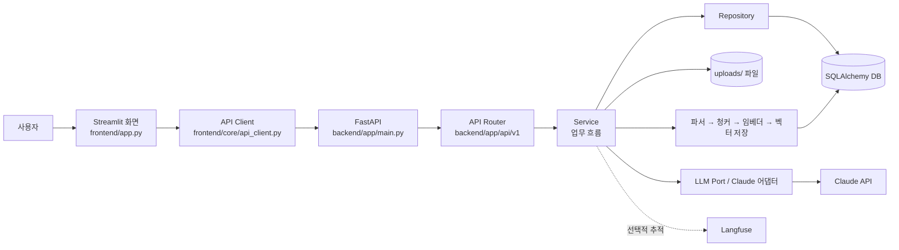
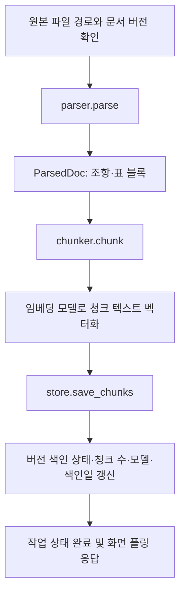
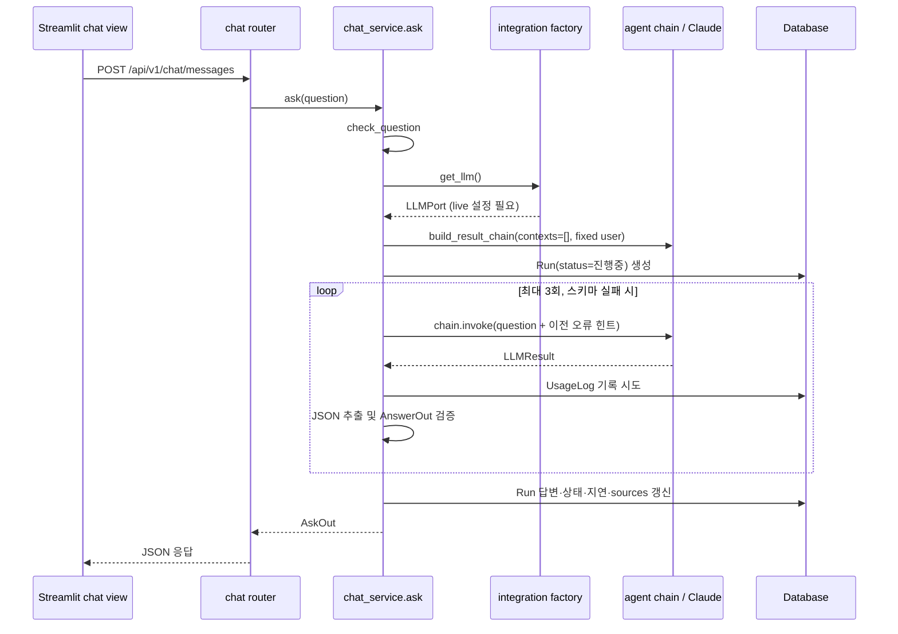

# Hanwha Agent 전체 프로세스 흐름

이 문서는 저장소의 현재 실행 코드(`backend/`, `frontend/`)를 기준으로 앱의 시작부터 로그인, 문서 관리·적재, 채팅 응답, DB 및 외부 연동까지의 흐름을 설명합니다. `sandbox/`는 개발·실험 코드가 많아 운영 경로와 구분했습니다. 기존 `DEVELOPMENT_FLOW.md`의 설명을 그대로 옮기지 않고 현재 코드에서 실제 연결되는 부분과 아직 연결되지 않은 부분을 나누어 기록합니다.

## 1. 한눈에 보는 구성



- **프론트엔드**는 Streamlit으로 화면을 그리고 `frontend/core/api_client.py`를 통해 백엔드 HTTP API를 호출합니다.
- **백엔드**는 FastAPI 라우터가 요청을 받고, 서비스 계층이 검증·업무 로직·트랜잭션 및 외부 연동을 조정합니다.
- **저장소**는 문서 파일을 `uploads/`에 저장하고, SQLAlchemy 모델로 사용자·문서·버전·청크·실행 기록·사용량을 DB에 저장합니다.
- **RAG 구성 요소**(파서, 청커, 임베더, 벡터 저장 및 검색 코드)는 존재합니다. 다만 현재 채팅 서비스는 벡터 검색을 호출하지 않으며 빈 근거 목록을 사용합니다. 따라서 현재 채팅은 문서 기반 RAG 응답 경로까지 연결된 상태가 아닙니다.

## 2. 저장소 디렉터리와 책임

| 경로 | 역할 |
|---|---|
| `backend/app/main.py` | FastAPI 앱 생성, 시작 수명주기, 라우터 등록, 공통 예외 변환 |
| `backend/app/api/v1/` | HTTP 경로, 요청 파라미터와 응답 스키마 연결 |
| `backend/app/services/` | 인증·문서·채팅 업무 흐름과 트랜잭션 조정 |
| `backend/app/repositories/` | DB 조회·저장 작업 |
| `backend/app/models/` | SQLAlchemy 테이블 모델 및 관계 |
| `backend/app/schemas/` | Pydantic 요청·응답 검증 모델 |
| `backend/app/rag/` | 문서 파싱·청킹·임베딩·벡터 저장 및 정책 코드 |
| `backend/app/integrations/` | LLM·임베딩 포트, 어댑터, 팩토리, Langfuse 연동 |
| `backend/app/agent/` | 프롬프트와 LangChain Runnable 체인 구성 |
| `frontend/app.py` | Streamlit 진입점과 로그인 후 화면 라우팅 |
| `frontend/views/` | 로그인, 채팅, 문서 목록·업로드·상세 화면 |
| `frontend/core/` | API 호출, 사용자 세션, 화면 이동 관리 |
| `frontend/ui/`, `frontend/asset/` | 공통 UI 구성요소와 스타일 |
| `backend/tests/` | 백엔드 단위·계층·시나리오 테스트 |
| `sandbox/` | 학습 노트북, 샘플, 실험 스크립트. 현재 앱 요청 경로가 직접 호출하지 않음 |
| `uploads/` | 업로드된 원본 파일 저장 경로 |

일반적인 의존 방향은 `api → services → repositories/models`입니다. 서비스가 DB 세션을 열고 Repository를 호출하며, 라우터는 서비스 결과를 응답 모델로 반환합니다. 외부 LLM 구현 선택은 `integrations.factory`가 맡습니다.

## 3. 서버 실행과 초기화

### FastAPI 앱

실제 서비스 앱은 `backend/app/main.py`의 `app`입니다. `backend/main.py`에는 별도의 간단한 `/health` 앱도 있으므로 실행 명령에서 어느 모듈을 가리키는지 확인해야 합니다.

FastAPI 앱의 lifespan 시작 순서는 다음과 같습니다.

1. `setup_logging()`으로 로깅을 준비합니다.
2. `init_db()`가 SQLAlchemy 모델 메타데이터를 이용해 테이블을 준비합니다.
3. `seed_all()`이 초기 데이터를 구성합니다.
4. `yield` 이후 서버가 요청을 처리합니다.

앱에는 `/health`와 `/api/v1` 아래의 문서·인증·채팅 라우터가 등록되어 있습니다. `AgentError`는 예외의 HTTP 상태와 `code`, `message`, `detail` 형태로 변환됩니다. Pydantic 요청 검증 오류는 422와 `validation_failed` 응답으로 변환되며, 오류 응답에는 입력값 자체 대신 문제가 된 필드가 들어갑니다.

### 설정과 DB

`backend/app/core/config.py`의 설정 객체가 `.env` 및 환경 변수를 읽습니다. 코드상 DB 기본 URL은 SQLite(`sqlite:///./app.db`)이며, `docker-compose.yml`은 PostgreSQL과 pgvector 컨테이너를 정의합니다. 실제 연결은 `DATABASE_URL` 설정에 따라 달라집니다. Compose 파일에는 기본 PostgreSQL과 `langfuse` 프로필 서비스가 있습니다.

`session_scope()`는 서비스의 DB 작업을 감싸는 세션 경계입니다. 정상 종료 때 커밋하고 예외 때 롤백하며 마지막에 세션을 닫습니다. 모델에는 부서·사용자, 문서·버전·청크, Run·RunStep, UsageLog 등이 정의되어 있습니다.

## 4. 프론트엔드 화면 흐름

1. Streamlit은 `frontend/app.py`에서 페이지 설정과 CSS를 적용합니다.
2. `session.init_state()`가 세션 상태를 초기화합니다.
3. 로그인 상태가 아니면 `views/login.py`를 렌더링하고, 로그인 상태면 사이드바와 현재 페이지를 렌더링합니다.
4. `frontend/core/router.py`는 `st.session_state["page"]`를 읽고 변경합니다. 기본 화면 키는 `login`입니다.
5. 화면 선택은 `chat`, `documents`, `document_upload`, `document_detail`로 분기합니다.
6. 각 화면은 `frontend/core/api_client.py`의 함수로 FastAPI를 호출합니다.

API 클라이언트는 `API_BASE_URL` 환경 변수를 사용하며 기본값은 `http://127.0.0.1:8000`입니다. 기본 timeout은 10초이고, 연결 오류·시간 초과·HTTP 오류를 `ApiError`로 화면에 전달합니다. `emp_no`가 주어지면 `X-Emp-No` 헤더를 설정합니다.

## 5. 로그인과 사용자 정보

### 로그인

```text
로그인 화면
  → POST /api/v1/auth/login {emp_no, password}
  → auth router
  → auth_service.authenticate()
  → user_repo.get_by_emp_no()
  → verify_password(입력 비밀번호, 저장된 해시)
  → UserOut 형태 반환
  → 프론트 세션에 사용자 정보 저장
```

사번 사용자가 없거나 비밀번호가 맞지 않으면 `AuthFailed`가 발생하고 공통 예외 처리 경로로 전달됩니다. `_to_out()`은 ID, 사번, 이름, 부서, 역할, clearance를 반환합니다.

### 현재 인증의 한계

`GET /api/v1/auth/me`는 JWT가 아니라 `X-Emp-No` 헤더의 사번을 받아 사용자를 조회합니다. 문서 목록·업로드 화면도 해당 헤더를 보낼 수 있지만, 채팅 라우터는 사용자 인증 정보를 서비스로 전달하지 않습니다. 현재 채팅 서비스의 `user_id=1`과 `DEFAULT_USER`는 임시 고정값입니다. 따라서 인증과 실제 요청 사용자에 기반한 채팅 권한 연결은 아직 완성되지 않았습니다.

## 6. 문서 목록과 상세 조회 흐름

문서 관리 화면은 지표와 문서 목록을 각각 API로 가져옵니다.

```text
문서 관리 화면
  ├─ GET /api/v1/documents?limit=100&필터...
  │    → documents router
  │    → document_service.list_documents()
  │    → document_repo.list_documents()
  │    → Document / 현행 DocumentVersion 조회
  │    → _to_out()으로 화면용 데이터 변환
  └─ 지표 계산: 목록 응답의 개수와 상태를 프론트에서 집계
```

화면 필터는 부서, 보안 등급, 상태, 검색어입니다. 서비스는 Repository 결과를 `_to_out()`으로 바꾸어 문서 ID·제목·부서명·버전·보안 등급·파일 형식·기간·인덱스 상태를 반환합니다. `GET /api/v1/documents/{doc_id}`는 현행 버전을 포함해 단건을 반환하고, `GET /api/v1/documents/{doc_id}/versions`는 해당 문서의 버전별 색인 상태와 청크 수 등을 반환합니다. 문서가 없거나 현행 버전이 없으면 `NotFound`가 발생합니다.

## 7. 문서 업로드 및 적재 파이프라인

현재 업로드 라우터(`backend/app/api/v1/documents.py`)가 받는 확장자는 `.docx`, `.pdf`입니다. 파서 계층은 더 많은 형식을 지원하지만 이 API 검증을 통과하지 못하면 업로드할 수 없습니다.

### 업로드 요청

```text
Streamlit 업로드 폼
  → POST /api/v1/documents (multipart form + file)
  → 확장자 검사 (.docx / .pdf)
  → 파일을 uploads/{doc_id}_{version}.{ext}에 기록
  → document_service.create_document()
  → DB에 Document / DocumentVersion 등록 또는 갱신
  → start_ingest_job()으로 작업 ID 생성
  → FastAPI BackgroundTasks에 run_ingest_job() 등록
  → job_id를 프론트에 반환 (201)
```

기존 문서에 같은 버전이 이미 있으면 `ValidationFailed`입니다. 새 버전을 등록할 때 기존 현행 버전은 만료로 바뀌고, 만료일은 새 버전 시행일 전날이며 인덱스 상태는 `보관`으로 바뀝니다. 새 버전은 현행·대기 상태로 생성됩니다. 새 문서라면 `Document`도 함께 생성됩니다.

### 백그라운드 적재

프론트는 응답에서 받은 작업 ID를 세션에 저장하고 `GET /api/v1/documents/jobs/{job_id}`를 약 1초 간격으로 요청해 진행 상태를 표시합니다. 백그라운드 작업은 다음 순서로 처리합니다.



세부 단계:

1. **파싱** — `rag/parser.py`가 확장자를 기준으로 적절한 파서를 선택합니다. 평문·Markdown·HTML은 자체 처리하고, 나머지는 `local_parsers.py`의 로컬 파서로 넘깁니다. 로컬 파서는 DOCX 문단·표, PDF 페이지 텍스트(옵션에 따라 표 추출), HWPX, XLSX, PPTX를 처리합니다. 일부 스캔 PDF처럼 텍스트가 추출되지 않는 경우 오류로 안내합니다. 업스테이지 파서는 `use_upstage=True` 경로에서 선택할 수 있지만, 현재 `ingest_document()`는 기본 `parser.parse(path)` 호출이라 그 옵션을 켜지 않습니다.
2. **중간 표현** — 파서는 원본 형식을 `ParsedDoc`과 `ParsedBlock`으로 통일합니다. 블록에는 종류(조항/표), 위치(locator), 본문이 담기고 문서의 페이지 수와 표 수도 관리됩니다. 표는 Markdown 표 문자열로 표현됩니다.
3. **청킹** — `rag/chunker.py`는 표 블록을 각각 독립 청크로 보존하고, 본문은 장·절·부칙 및 조 번호를 기준으로 나눕니다. 긴 본문은 최대 1,200자 크기로 재분할합니다. 위치 정보는 청크 locator에 붙습니다.
4. **임베딩** — `rag/embedder.py`는 팩토리에서 임베더를 받아 청크 텍스트를 최대 50개씩 벡터화합니다. 설정에 따라 로컬 임베더 또는 Upstage 임베더가 선택됩니다.
5. **저장** — `rag/store.py`가 해당 버전의 이전 청크를 삭제하고 새 청크의 텍스트·종류·위치·벡터를 저장하며 `chunk_count`를 갱신합니다.
6. **완료 표시** — 서비스가 인덱스 상태를 `완료`, 진행률 100으로 설정하고 임베딩 모델과 색인일을 저장합니다. 작업 사전에 완료 상태·청크 수·요약을 기록합니다.

재색인은 `POST /api/v1/documents/{doc_id}/versions/{version}/reindex`로 시작합니다. 버전을 확인하고 기존 파일 경로를 가져온 뒤 상태를 `재임베딩`으로 바꾸고 같은 백그라운드 적재 경로를 실행합니다.

### 작업 상태의 저장 방식

현재 작업 진행 정보(`_JOBS`)는 `document_service.py`의 프로세스 메모리 딕셔너리입니다. 서버가 재시작되거나 여러 워커에서 요청이 분산되면 작업 상태를 계속 조회할 수 있도록 공유 DB나 작업 큐에 저장하는 구조는 아닙니다. 또한 현재 단계 목록은 작업의 시작/완료 중심으로 갱신되며 단계별 실시간 진행 콜백은 임베딩 함수에 준비되어 있지만 작업 서비스에서 연결하지 않습니다.

## 8. RAG 검색 코드의 현재 연결 상태

RAG 관련 기반 코드는 구현되어 있습니다.

- `rag/embedder.py`: 문서 및 질문 임베딩 진입 함수
- `rag/store.py`: 청크 벡터 저장 및 cosine distance 기반 `vector_search()`
- `rag/policy.py`: 현행/과거 버전 및 사용자 clearance에 따른 후보 필터
- `integrations/ports.py`: 파싱 결과·임베더·LLM의 공통 데이터 계약

그러나 **현재 채팅 요청 경로는 위 검색 함수를 호출하지 않습니다.** `chat_service.ask()`에서 `NO_CONTEXTS = []`를 넘기고, 사용자도 `DEFAULT_USER` 고정값으로 체인을 구성합니다. 따라서 문서를 업로드해 청크와 벡터를 DB에 적재해도, 현재 질문과 유사한 청크 검색·보안 등급 필터·검색 근거 전달은 채팅 흐름에 반영되지 않습니다. 프롬프트는 근거 문서가 없음을 처리하도록 작성되어 있을 수 있지만, 실제 근거 검색이 연결되기 전에는 문서 기반 답변이라고 볼 수 없습니다.

## 9. 채팅 질문에서 응답까지

채팅 화면은 질문을 `POST /api/v1/chat/messages`로 보내고 응답의 `answer`를 대화에 추가합니다. API 라우터는 `ChatRequest`를 검증한 뒤 `chat_service.ask()`를 호출합니다.



### 질문 검증과 LLM 선택

`ChatRequest` 스키마와 `core/guards.py`가 질문 길이 등을 검사합니다. 서비스의 `check_question()`은 양끝 공백 및 질문 끝의 물음표 등을 정리하고 추가 입력 길이 규칙을 적용합니다. 이후 `integrations.factory.get_llm()`이 LLM 포트를 요청합니다. 팩토리는 `APP_MODE=live`가 아니면 현재 mock 어댑터를 제공하지 않고 `ModeNotAvailable`을 발생시킵니다. live에서는 Claude 어댑터를 생성하고 재사용합니다.

### 프롬프트와 결과 검증

`agent/chain.py`가 `answer_system.md`를 system 프롬프트로, 사용자 질문을 human 입력으로 묶어 Runnable 체인을 구성합니다. Claude 어댑터는 `LLMResult`(텍스트, 모델명, 토큰 사용량, 비용 등의 메타데이터)를 돌려줍니다. 서비스는 응답 텍스트에서 JSON을 추출하고 `AnswerOut`으로 검증합니다.

스키마 검증이 실패하면 오류 필드와 메시지를 힌트로 붙여 다시 요청합니다. 서비스 루프는 최대 3회입니다. 세 번 모두 구조 검증에 실패하면 고정 폴백 문구와 `fallback_used=True`, `enough_evidence=False`를 반환합니다. 체인에도 `with_retry(stop_after_attempt=2)`가 있어 LLM 호출 자체의 예외 재시도가 별도로 설정되어 있습니다. 이는 서비스의 JSON 스키마 재시도 횟수와 다른 층의 동작입니다. LLM 호출 예외는 서비스의 `ValidationError` 처리와 별개이므로 자동 폴백 응답으로 바뀐다고 가정하면 안 됩니다.

### 실행 기록과 사용량

LLM 호출 전에 `Run`을 `진행중` 상태로 저장합니다. 호출 결과마다 `_record_usage()`가 `UsageLog` 저장을 시도하고, 기록 실패는 경고만 남기도록 처리합니다. 최종적으로 Run의 답변·완료 상태·지연 시간·출처 목록을 갱신합니다. `GET /api/v1/chat/runs/{run_id}`는 이 실행 기록을 조회합니다.

Langfuse `trace()` 컨텍스트는 코드상 Run 저장 후 진입하지만, 현재 구현에서는 `with trace(...):` 블록 안에 `out = None`만 있고 실제 LLM 호출 루프는 블록 바깥에 있습니다. 그러므로 현재 코드만으로는 trace가 전체 LLM 요청을 감싼다고 볼 수 없습니다. 스키마 검증이 최종 실패한 경우 `schema_ok=0` 점수를 기록하고, 성공 점수 기록 코드는 보이지 않습니다.

## 10. 어댑터, 외부 서비스 및 컨테이너

- **LLM** — `LLMPort` 계약을 서비스가 사용하고, `factory.py`가 설정을 바탕으로 Claude 어댑터를 선택합니다. 서비스 코드는 구체 Claude SDK 대신 포트에 의존합니다.
- **임베딩** — 같은 팩토리가 `embed_provider` 설정에 따라 로컬 모델 또는 Upstage 임베더를 선택합니다.
- **Langfuse** — 설정이 활성화된 경우 추적·점수 기록 함수를 사용할 수 있습니다. 실제 적용 범위는 위의 trace 블록 위치를 기준으로 확인해야 합니다.
- **PostgreSQL/pgvector** — `docker-compose.yml`의 PostgreSQL 컨테이너는 벡터 확장을 포함한 이미지입니다. 애플리케이션이 PostgreSQL을 사용하려면 DB URL 및 스키마 설정이 그 환경과 일치해야 합니다.
- **Langfuse 컨테이너** — Compose의 `langfuse` 프로필에 포함되어 기본 실행만으로는 시작되지 않습니다.

## 11. 에러가 사용자에게 돌아가는 경로

```text
라우터 / 서비스 중 예외 발생
  → AgentError 계열이면 공통 예외 핸들러
  → HTTP 상태 코드 + {code, message, detail}
  → API Client가 4xx/5xx 응답을 ApiError로 변환
  → 해당 Streamlit 화면에서 st.error 등으로 표시
```

요청 데이터 검증 실패는 FastAPI `RequestValidationError` 핸들러가 422로 반환합니다. 문서 형식 미지원·중복 버전·존재하지 않는 문서/작업 등은 서비스 또는 파서에서 도메인 예외를 발생시킵니다. 문서 적재 백그라운드 예외는 작업 상태를 `실패`로 바꾸고 메시지를 기록합니다.

## 12. 주요 데이터 흐름

```text
업로드 메타데이터 ──→ Document / DocumentVersion
원본 파일 ─────────→ uploads/{문서ID}_{버전}.{확장자}
파싱 블록 ─────────→ ParsedDoc / ParsedBlock (메모리)
청크 텍스트·위치 ──→ Chunk
청크 임베딩 벡터 ──→ Chunk.embedding
질문·응답·상태 ────→ Run
LLM 모델·토큰·비용 → UsageLog
실행 세부 단계 ────→ RunStep (스키마 확장용 모델)
```

문서 파일 자체는 DB가 아니라 파일 시스템에 저장되고, 버전 레코드가 파일 경로를 참조합니다. 청크와 벡터는 DB에 저장됩니다. 검색 코드는 이 벡터를 대상으로 하지만 채팅 서비스에 연결되지 않은 상태입니다.

## 13. 코드에서 확인되는 구현 경계

현재 코드를 따라가며 읽을 때 다음 사항을 구분해야 합니다.

1. `backend/main.py`의 간단한 health 앱과 실제 `backend/app/main.py` 앱은 별도 진입점입니다.
2. API 업로드는 DOCX/PDF만 허용하지만 로컬 파서에는 HWPX, XLSX, PPTX 등 추가 구현이 있습니다. 파서 지원만으로 업로드 API가 그 형식을 허용하는 것은 아닙니다.
3. 문서 색인·벡터 검색 코드는 있으나 채팅 서비스에서 검색을 실행하거나 결과를 컨텍스트로 전달하지 않습니다.
4. 채팅의 사용자/사용자 ID는 고정 임시값이고, `X-Emp-No` 인증 정보가 채팅으로 이어지지 않습니다.
5. 작업 상태는 프로세스 메모리에 저장되므로 서버 재시작·다중 워커 상황에서 영속적인 상태 조회를 제공하지 않습니다.
6. 설정에서 live 모드가 아니면 LLM mock 구현이 제공되지 않습니다.
7. Langfuse trace 블록이 LLM 호출 루프를 둘러싸지 않아 전체 호출 trace로 동작하지 않습니다.

이 경계들을 바탕으로 전체 제품 흐름을 요약하면, **문서 관리 UI → API → 파일/DB 등록 → 백그라운드 파싱·청킹·임베딩·저장** 흐름과 **채팅 UI → API → 질문 검증·LLM 호출·응답 스키마 검증·실행/사용량 기록** 흐름은 각각 존재합니다. 현재 두 흐름을 RAG 검색 컨텍스트와 실제 로그인 사용자 정보로 잇는 단계는 구현되어 있지 않습니다.

## 14. 주요 코드 찾아보기

- 앱 수명주기와 라우터: `backend/app/main.py`
- 문서 HTTP API: `backend/app/api/v1/documents.py`
- 문서 등록·적재 작업: `backend/app/services/document_service.py`
- 파싱 선택: `backend/app/rag/parser.py`, `backend/app/rag/local_parsers.py`
- 청킹: `backend/app/rag/chunker.py`
- 임베딩 진입점: `backend/app/rag/embedder.py`
- 청크 저장 및 벡터 검색: `backend/app/rag/store.py`
- 검색 권한·버전 정책: `backend/app/rag/policy.py`
- 채팅 HTTP API: `backend/app/api/v1/chat.py`
- 채팅 업무 흐름: `backend/app/services/chat_service.py`
- 체인·프롬프트: `backend/app/agent/chain.py`, `backend/app/agent/prompts/answer_system.md`
- LLM/임베딩 어댑터 선택: `backend/app/integrations/factory.py`
- 프론트 진입·페이지 전환: `frontend/app.py`, `frontend/core/router.py`
- 프론트 HTTP 요청: `frontend/core/api_client.py`
